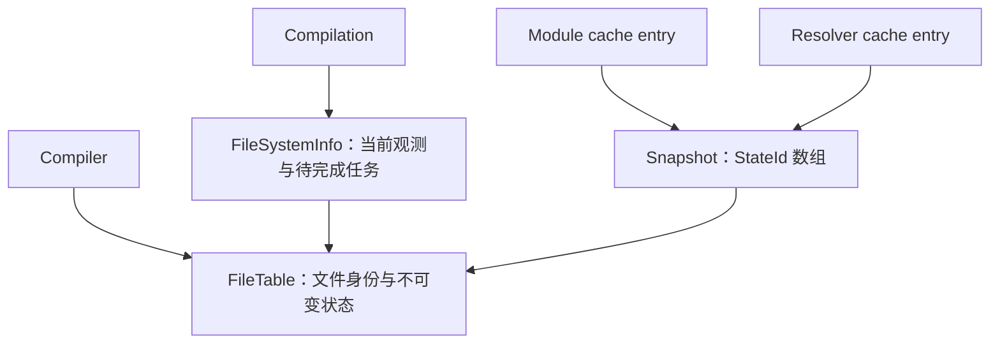

# FileSystemInfo 设计与实施计划

状态：第 1 步已实现并通过验证，第 2～16 步待实现。本文档是后续逐步实现的基准。

整理日期：2026-10-23。

实现位置：/Users/bytedance/GitHub/rspack3/crates/rspack_core/src/new_cache/fs_info/。

本文整合共享表、快照表示、IO 去重、生命周期、内存回收、持久化接入和 16 个实施步骤。结构示例表达设计关系，不代表已经存在的 Rust API 或经过测量的最终布局。

## 1. 目标与边界

实现一套新的 FileSystemInfo，以 webpack 的功能和校验语义作为主要参考。重新设计数据结构和执行方式，不参考 Rspack 已有 FileSystemInfo 的内部实现。

例外是 immutable_paths、managed_paths、unmanaged_paths：这三个配置保持当前 Rspack 的行为，具体规则见第 8 节。

主要目标：

- 同一文件系统命名空间中的同一路径只有一个存活的 FileEntry。
- 同一有效观察范围内，相同事实的并发请求合并，已完成结果复用。
- 多个 snapshot 共享不可变状态，单条普通依赖引用保持 4 字节。
- Snapshot 不使用 epoch 判断文件是否变化，也不引用可被覆盖的“当前值”。
- Compilation FSI 和 session FSI 分别管理自己的当前观测。
- 无使用者的状态、文件身份、路径和辅助索引能够回收，槽位可以安全复用。
- 持久化按批次共享数据；磁盘缓存的存在不要求对应对象常驻内存。
- 保持 Cache 与 Incremental 的独立性，Cache 不拥有上一轮 Compilation。

“最好性能、最少内存”是优化目标，需要使用真实工作负载验证，不能仅由索引大小推导。总成本必须包含状态记录、引用计数、查找索引、分配容量、临时 IO buffer 和持久化缓存。

### 1.1 “只做一次”的范围

去重单位是：

```text
文件系统命名空间 + 有效观察范围 + 文件身份 + 操作类型
```

在这个范围内，结果未失效、未被淘汰时，同一种必要观测只执行一次。metadata、read、read_dir 等是不同操作，不能把它们统称为“一次 IO”。能够由已有结果回答的操作应直接复用，例如存在性查询复用 metadata。

文件变化、进入新观察范围或因内存预算淘汰结果后，可以重新读取。正在变化的文件也可能需要重新观测，或者放弃为本次计算生成可用快照。

“任意文件整个 session 永远只读一次”“文件可以变化”“内存有固定上限”无法同时保证。外部 loader 或 resolver 的重复 IO 只有接入统一观测入口或提供可靠读取结果后，才能一起消除。

### 1.2 后续实现约定

所有步骤都优先复用标准库、仓库已有工具和现成 crate，保持实现简单、直观。实现重点是 FileSystemInfo 的所有权、文件有效性、观测去重和生命周期，不预先开发通用的分配器、分页容器、哈希表或并发框架。

现成方案能够满足功能和回收要求时，接受其明确的元数据与容量开销。只有出现明确的功能缺口或实测瓶颈，才考虑增加专门的数据结构。当前路径索引和文件槽位分别使用默认配置的 DashMap 与 `sharded-slab`。由 crate 管理分片、分页和槽位复用，不维护自定义分片参数或 ID 位编码，也不在 Slab 外加全局 Mutex。FileId 保存完整的 `usize` key；无人使用的记录及其资源能够回收，页面容量保留到整个 FileTable 释放，即使表已清空也不自动收缩。

分步实现期间按需构建、测试和检查格式；Clippy 留到整套实现完成后统一执行，详见第 12 节。

## 2. 核心架构

明确区分三个对象：

| 对象 | 含义 | 生命周期 |
| --- | --- | --- |
| FileEntry | 一个文件系统命名空间中的路径身份 | 有观测、任务或快照状态使用时存在 |
| Observation | 当前观察范围内取得的文件事实 | Compilation 或 session 内的有效观察范围 |
| SnapshotState | 缓存结果要求文件满足的不可变条件 | 有快照、观测或任务引用时存在 |

FileTable 保存文件身份和不可变状态。FileSystemInfo 保存当前观测、待完成任务和校验结果缓存。Snapshot 只拥有共享表及自己使用的状态引用。



Pack 使用 session FSI。同一文件系统命名空间可以共享 FileTable；不同文件系统使用各自的表。共享表不表示共享当前观测。

### 2.1 不覆盖历史预期值

```text
文件表：
  FileId 7 -> /src/a.js

状态表：
  StateId 21 -> { file: 7, expected_hash: H1 }
  StateId 35 -> { file: 7, expected_hash: H2 }

Snapshot A -> [21]
Snapshot B -> [21]
Snapshot C -> [35]
```

/src/a.js 只有一个 FileEntry。A、B 共享 H1；C 使用 H2。释放 A、B 后，状态 21 可以回收。

一个文件变化后，旧 snapshot 仍然需要旧值。保留这些仍被引用的值是快照语义的必要成本，它们不等于重复创建文件身份 entry。

StateId 表示具体状态，与时间顺序无关。文件从 A 变成 B 再变回 A，如果 A 的状态仍存活，就复用 A 的状态；否则重新建立等值状态也不影响正确性。

## 3. 核心数据结构

```rust
struct FileTable {
    files: FileArena,
    states: StateArena,
    file_index: FileIndex,
    state_index: StateIndex,
}

struct FileSystemInfo(Arc<Runtime>);

struct Runtime {
    table: Arc<FileTable>,
    observations: ObservationCache,
    pending: PendingOperations,
    validations: ValidationCache,
    // 文件系统、策略、logger 等运行时配置。
}

#[repr(transparent)]
struct StateId(u32);

struct Snapshot(Arc<SnapshotData>);

struct SnapshotData {
    table: Arc<FileTable>,
    start_time: Option<u64>,
    dependencies: Box<[StateId]>,
    ranges: DependencyRanges,
}
```

这是概念结构。具体类型可见性、分片方式、字段顺序和分池编码在对应实现步骤中确定。

### 3.1 文件身份

FileEntry 保存路径身份，不强引用全部历史状态，也不保存一个供所有 FSI 共用的可变“当前值”。

FileId 直接包装 `sharded-slab` 的 `usize` key，在 64 位平台上占 8 字节。key 内部的 generation 用于槽位复用，不是文件观察 epoch。FileId 只存于共享状态中；snapshot 的 4 字节 StateId 仍是第 2 步的设计目标，不能把默认 Slab key 直接截断成 StateId，也不能假设状态池可以无调整套用文件槽位的表示。

- 路径查找在明确的文件系统命名空间内进行，不能仅凭路径字符串相同就跨文件系统共享。
- 路径字符串使用可回收的共享表示，查找索引避免再次保存完整字符串副本。
- 不为去重而对所有路径执行 realpath；逻辑路径和 symlink 路径可能有不同的依赖语义。
- 路径分类由相应策略和观察范围管理，不能将某一配置下的匹配结果无条件复用于另一配置。

### 3.2 不可变状态

以 FileId、校验类型及完整预期值作为状态相等条件。散列只用于查找，命中后仍比较完整值，不把短 hash 当作唯一身份。

| 状态类型 | 需要保存的预期信息 |
| --- | --- |
| 文件 timestamp | 文件身份、预期 timestamp 或相应存在性状态 |
| 文件 hash | 文件身份、完整二进制 digest 或明确的特殊状态 |
| 文件 timestamp/hash | 文件身份、预期 timestamp 和完整 digest |
| context | 根路径身份、对应策略的目录聚合结果 |
| missing | 原始路径身份、预期存在性 |
| immutable | 用于依赖迭代和 watch 的原始路径身份 |
| managed | 原始文件身份、共享的包身份预期值 |

大字符串等包身份信息可以共享。timestamp、短 digest 等小标量直接放进对应状态，取消“每个小值分别建立通用值池”的方案。

不同类型分池存放，避免较大 enum 变体或 SHA-256 撑大所有记录。hash 算法必须被状态的类型或所属配置明确区分，保留完整 digest，不为缩小记录而截断。

StateId 的具体编码需要保证 4 字节；若使用类型标签与槽位索引组合，必须明确容量边界并检查溢出，不能静默回绕。

### 3.3 Snapshot 布局

FileId 放在共享状态里，snapshot 只保存 StateId。DependencyRanges 区分 file、context、missing 等依赖，避免在每条引用中重复保存分类。

| 表示方式 | 单条依赖引用大小 |
| --- | ---: |
| FileId + u32 ValueId，紧凑布局 | 12 字节 |
| FileId + 64 位值 | 16 字节 |
| FileId + 64 位 timestamp + 64 位 hash | 24 字节 |
| StateId | 4 字节 |

以上按 64 位平台的 FileId 计算。12 字节的对比以紧凑字节表示为前提；直接使用普通 usize/u32 Rust 结构可能因对齐产生额外空间。4 字节 StateId 是待实现的状态池目标。以上不包含共享记录、索引、快照头和分配开销。

总内存近似为：

```text
依赖引用数 × 4 字节
+ 存活的不同状态
+ 文件身份及路径
+ 查询索引与分配容量
+ 当前观测、任务和持久化临时数据
```

没有共享的一次性依赖可能以内联值更省。采用共享状态的主要收益来自 module、resolver 和多个 snapshot 之间的重复引用，最终需要测量这种共享比例。

## 4. 生命周期与使用方式

| 对象 | 创建与释放规则 |
| --- | --- |
| Compilation FSI | 每次 Compilation 新建，module/resolver 共用；其使用结束后清理当前观测和任务 |
| Session FSI | Pack 整个 session 持有；内部观测可失效和按预算淘汰 |
| FileTable | Compiler、FSI 或 snapshot 持有时存在；内部记录独立回收 |
| Snapshot | 跟随缓存条目、模块或实际使用者 |
| Pending IO | 操作和等待者结束后释放临时所有权 |
| 归档读取缓存 | 按需创建，按预算淘汰 |

通常由 Compiler 持有对应文件系统命名空间的 FileTable。共享表的基础设施不应依赖 incremental 是否开启，也不能让 cache: false 隐式关闭 Incremental。

Snapshot 不持有 FSI、Compilation、文件系统、logger 或任务队列。FileTable 也不通过回调或其他字段间接持有这些对象。

如果增量编译合法保留旧 Compilation，不应通过 snapshot 再建立额外的 Compilation 保留链。清理运行时缓存前必须确认相关任务已完成或取消；异步写盘只持有 snapshot 所需的数据。

### 4.1 旧快照与新观测

旧 snapshot 的状态是历史校验基准，不是新 Compilation 已经读取到的当前值。新 FSI 可以使用可信 watcher 信息，否则应取得所需的当前观测。

Session FSI 长期存活，也不意味着文件事实永远有效。相关文件变化时清理受影响观测；难以安全局部失效的派生结果，可以清理整个相关观察范围。

失效必须包括目录聚合、package 查找中的正负结果和 snapshot 校验缓存。正在执行的旧操作不能把结果重新发布到新的观测槽位；可以让任务绑定它开始时的观测对象，失效时从查找入口移除该对象。

### 4.2 调用方接口

```rust
// 使用当前 Compilation 的观测验证旧快照。
let valid = fs_info.check_snapshot_valid(&cached.snapshot).await?;

// 需要重新计算时，完成实际工作并收集依赖。
let snapshot = fs_info
    .create_snapshot(start_time, &dependencies, strategy)
    .await?;

cache.store(CacheValue::new(CachedResult {
    result,
    snapshot,
}));
```

调用方不操作裸 StateId、引用计数、归档批次和磁盘回收。具体函数签名在实现时与现有调用点协调。

## 5. 内存回收

### 5.1 引用关系

```text
SnapshotData -> SnapshotState -> FileEntry
当前观测     -> 使用中的状态或 FileEntry
正在执行的任务 -> 完成操作所需的数据
managed 状态 -> 共享的包身份状态
```

查找索引不作为保活引用。FileEntry 不强引用历史状态。状态之间仅允许有方向明确、无环的所有权关系；context 聚合不通过永久强引用保留整个遍历图。

状态使用槽位内的引用计数，不为每个状态独立分配 Arc。Snapshot clone 只增加 `Arc<SnapshotData>` 的计数。

### 5.2 释放流程

1. 最后一个 SnapshotData 释放时，按存储池批量释放它引用的状态。
2. 状态引用归零后，在对应同步保护下从去重索引移除。
3. 销毁状态内容，释放它拥有的文件身份及子状态引用。
4. 槽位进入复用集合；文件身份无人使用后同样回收。
5. 索引按阈值收缩；文件 Slab 的空槽用于复用，页面容量在 FileTable 的最后一个所有者释放后一起回收。

例如，一份当前观测和一份 snapshot 共同拥有状态 V：观测结束后 V 继续服务 snapshot；缓存淘汰最后一份 snapshot 后 V 归零回收。

持有 `Arc<FileTable>` 只保证表容器存在，不使已归零的内部记录继续存活。

### 5.3 安全复用槽位

StateId 和 FileId 是受所有权保护的内部句柄，不允许裸 ID 脱离拥有者进入异步任务或其他缓存。

- 查找、增加引用、归零删除和槽位复用遵循一致的索引与槽位同步规则。
- 读取记录内容期间持有有效引用或相应访问保护，不能在解锁后使用可能释放的借用。
- 弱查找索引中的 ID 必须在保护下验证并获取所有权。
- 校验缓存不能用可能已复用的裸 ID 或地址作为无条件有效的缓存键。
- 引用计数溢出不能回绕。
- 释放复合状态的子引用时，避免递归持锁或以相反顺序获取多把锁造成死锁。

这些约束成立时，不需要另给每条 snapshot 引用附加 generation。文件 Slab 自带的 generation 作为 opaque key 的一部分原样保存，不自行解码或截断。

### 5.4 控制历史容量

FileTable 直接使用默认配置的 `sharded-slab::Slab`，由 crate 管理并发分配、访问保护和槽位复用。业务引用归零后从路径索引删除，并用 `remove` 标记槽位回收；所有短期访问 guard 结束后，FileEntry 及其路径引用被销毁，空槽回到所属分片供后续分配复用。

`sharded-slab 0.1.7` 没有页面收缩接口；页面即使全部空闲也保留到 Slab 销毁。容量反映各分片的历史分配峰值与分配分布，不能只用全表最大存活文件数推算。稳定线程集合和工作集下的槽位复用由 crate 提供，实际长期容量在第 16 步测量；不承诺表清空后立即释放页面，也不为绕过这一限制再实现分页容器或并发替换层。

这是直接采用现成并发容器的明确取舍。Compiler、FSI、snapshot 和临时任务都不再拥有 FileTable 时，整个 Slab 及其页面随表一起释放。索引仍按阈值收缩，不因页容量保留而继续保留无人使用的文件记录。

验收应区分记录及其持有资源的回收、容器保留容量和进程 RSS；释放到分配器也不保证 RSS 立即下降。

校验缓存采用弱引用或有界记录；临时 snapshot 注册表、序列化引用、失败任务、取消任务和等待者都必须有明确释放路径。

## 6. IO 和计算共享

统一入口采用“未开始、正在执行、已完成”的状态转换：

```text
首次请求 -> 发起操作
并发请求 -> 等待同一操作
后续请求 -> 复用完成结果
```

执行原则：

- metadata 结果服务 timestamp 和存在性查询。
- hash 与 timestamp/hash 共享同一内容 digest。
- read_dir 的结果和稳定排序可以被多个目录聚合请求复用。
- 同一个 package.json 的读取、解析结果共享。
- 普通 IO 错误与“路径不存在”明确区分；在有效范围内共享相应结果。
- 只为 pending 操作分配等待结构，完成后转换成紧凑结果。
- 锁不跨 IO 持有；目录任务等待子任务时不占用 IO 并发额度。
- 单个等待者取消不应取消其他等待者仍需要的工作。
- CPU 工作使用 rayon，异步编排遵循仓库的 rspack_parallel 约定。

文件内容只在实际消费者需要期间保留。已经完成的观测优先保存 metadata、digest、解析结果等小数据。

接入外部读取时，应明确读取来源、文件系统命名空间、观察范围和内容一致性。不能把加工后的 loader 输出当成原始文件 hash，也不能把旧读取结果导入新的观察范围。

如果内容已被释放，而后来又有消费者需要原始 bytes，就可能需要重新读取；保留所有内容以追求永不重读会破坏内存目标。预算和临时内容交接在第 15、16 步中一起验证。

当前 ReadableFileSystem 的 read 返回完整 `Vec<u8>`，不能直接假定已有流式读取。大文件的流式 hash 如需引入，应作为明确的文件系统接口改进单独评估。

## 7. Snapshot 校验语义

### 7.1 普通文件

- Timestamp：比较当前事实与预期 timestamp，并处理存在性和 safeTime。
- Hash：按内容 hash 语义验证，保留完整 digest。
- Timestamp/hash：timestamp 和 safeTime 能证明有效时走快速路径，否则比较 hash。
- Missing：记录并验证实际预期存在性，不能把所有 missing dependency 都编码为“必须不存在”。

```text
取得当前 timestamp
    |
    +-- timestamp 相同且 safeTime 满足 snapshot.start_time -> 有效
    |
    +-- 否则 -> 取得当前 hash，与预期 hash 比较
```

timestamp/hash 状态同时保存两个预期值，不能让下一次 Compilation 的快速路径依赖已经销毁的旧运行时。

start_time 和 safeTime 是真实的时间与安全性信息，不是 epoch。mtime 精度不够、时间未知或读取与文件变化交错时，必须保守处理。

StateId 不同不能直接判无效：timestamp 改变而内容不变时，timestamp/hash 仍可能有效。StateId 相同也不能绕过当前观测和时间安全性条件。

特殊状态与正常 digest 明确区分，不能占用任意一个正常 hash 值作为 missing 或 directory 哨兵。读取错误的处理以功能语义为准，不能为了缓存命中而降级成“有效”。

### 7.2 Context 与 symlink

context 需要观察目录项和子项信息，不能只比较目录 mtime。目录项筛选和名称规范化遵循 webpack 的功能语义，使用稳定顺序产生聚合结果。

symlink 的本地信息读取与目标关系解析分开，使用显式的已访问集合等机制处理环。不能让两个共享的递归任务互相等待。

目录遍历中间结果属于当前运行时。快照保存需要的聚合状态及原始依赖身份，不永久保留完整遍历图。

### 7.3 合并、迭代与 build dependencies

提供 snapshot 合并和 file/context/missing 依赖迭代。合并复用状态，具体冲突处理和时间语义以 webpack 功能行为为基准固定用例，不能无条件覆盖旧约束。

build dependencies 除文件内容外还包括解析结果及其依赖：新增文件可能改变解析目标，即使旧目标的内容没有变化。收集过程与快照校验共享底层 IO，不把依赖解析逻辑塞进底层文件身份表。

## 8. 路径策略

优先级：

```text
unmanaged -> immutable -> managed -> 普通文件
```

- unmanaged：采用普通 snapshot 策略，并覆盖 immutable、managed 匹配。
- immutable：跳过常规测量，保留原始依赖路径供迭代和 watch 使用。
- managed：匹配后沿 parent 查找有效 package.json，以 name@version 作为包身份预期值；找不到时回退普通策略。
- 字符串匹配保持当前 starts_with 行为；正则保持当前 test 行为，不自行增加路径分隔符边界规则。

package 查找保持当前行为：

1. 语义上从给定路径下的 package.json 开始逐级向 parent 查找；已明确知道输入是文件时，可跳过不可能成立的子路径尝试。
2. 要求能够解析出非空字符串 name；version 缺失或不是字符串时使用空字符串。
3. 缺失、读取失败、无效 JSON 或没有有效 name 时继续向 parent 查找。
4. 检查到 compiler context 本身后停止；若祖先链不经过 context，则按当前行为继续到根。
5. 没有找到有效包身份时使用普通文件策略。

查找过程按目录缓存正负结果，并共享 package.json 的读取、解析结果。结果只在对应有效观察范围内成立。

验证 managed 文件时，需要重新确定当前所属的包，再按包身份语义比较。只检查上次找到的 package.json 会漏掉新增的、更近的 package.json。原始文件路径必须保留，不能仅剩包路径。

## 9. 持久化设计

### 9.1 运行时布局与归档布局分离

运行时优化并发查找和逐条回收；归档优化紧凑表示、共享数据和按需读取。运行时锁、等待者、引用计数、空槽位和当前观测不直接序列化。

```text
运行时：
CacheEntry -> Snapshot -> Arc<FileTable>

磁盘：
CacheEntry -> SnapshotKey -> 归档中的 snapshot

一个归档批次：
  文件表
  状态表
  多个 snapshot 的索引数组
```

StateId 是可复用的内存槽位；SnapshotKey 是持久化对象身份。磁盘不能保存裸运行时 StateId 并假定下次进程仍具有相同含义。

### 9.2 rkyv 的共享边界

同一个 serializer 中，指向同一对象的 Arc 可以只序列化一次。独立 serializer 不会自动跨缓存条目去重。反序列化的 Pool 也会保留共享对象直到自身释放。[rkyv Shared Pointers](https://rkyv.org/shared-pointers.html#shared-pointers)

当前缓存条目各自调用编码，且每次 to_bytes 创建新的 Share。因此，直接在每个条目中序列化 `Arc<FileTable>` 会重复写表。

采用有限大小的共享归档批次。归档根可以显式只保存一份表，也可以在同一 serializer 中使用 `Arc<FrozenTable>`；关键是共享同一归档边界，而不是仅添加 Arc 字段。

不同写入批次可能包含相同数据，这不是全 session 永远只序列化一次。归档淘汰后再次访问也允许重新读取；去重范围和内存预算需要一起定义。

### 9.3 写入流程

1. 编码缓存条目时登记它持有的 snapshot，payload 中写 SnapshotKey。
2. 只收集本批次成功编码条目实际引用的 snapshot。
3. 从这些根收集可达状态及路径，分配紧凑的归档索引。
4. 对本批次共享数据序列化一次，不扫描整个 session 的 FileTable。
5. 将缓存条目、snapshot 定位信息、引用变化和归档数据一致提交。
6. 成功或失败后释放本批次的临时所有权。

归档大小需要有上限，避免很小的缓存命中加载巨大的数据块。编码、写入失败不能留下永久引用或可见的悬空 SnapshotKey。

### 9.4 恢复流程

1. 根据 SnapshotKey 定位归档及 snapshot。
2. 按需访问归档，只导入实际需要的状态和路径。
3. 在运行时 FileTable 中按文件身份和完整状态去重，建立归档索引到运行时 ID 的映射。
4. 根据恢复出的实际所有者建立引用计数。
5. 使用当前 FSI 验证恢复出的预期状态。

归档索引映射不能永久保存可能已回收的裸运行时 ID。恢复后的历史状态不能写入当前观测缓存充当“已读取结果”。

归档 bytes、加载信息和必要的反序列化上下文采用有界生命周期。可以直接访问归档数据再导入所需行，避免为一个 snapshot 恢复整批对象。

### 9.5 磁盘回收与内存回收分开

| 事件 | 内存处理 | 磁盘处理 |
| --- | --- | --- |
| Compilation 使用结束 | 释放观测和任务数据 | 保留有效磁盘缓存 |
| 内存缓存淘汰 | 释放 snapshot 引用 | 磁盘条目可以继续存在 |
| 持久化条目替换或删除 | 释放旧内存引用 | 更新持久化 snapshot 引用关系 |
| 归档没有磁盘使用者 | 无需保留运行时对象 | 删除归档 |
| 归档只剩少量有效 snapshot | 不要求全部数据常驻 | 压缩归档并更新定位 |

磁盘引用关系及目录保存在存储中，内存只缓存热点定位信息。SnapshotKey 的间接定位允许压缩归档时更新位置，而不重写所有模块 payload。

仍被磁盘条目引用的归档不能因为运行时引用归零而删除；磁盘引用也不能使对应运行时状态常驻。

持久化格式遵循仓库策略：不新增旧格式 decoder、双写、迁移路径或格式版本后缀来绕开已有命名空间，使用正常缓存校验与 miss 处理。

## 10. 接入位置与资源预算

### 10.1 Compilation、module 和 resolver

Compilation 创建当前 FSI，module 和 resolver 共用实例。缓存条目持有 snapshot，下次 Compilation 用新的当前观测验证它。

保留依赖迭代及 watch 需要的原始信息。替换缓存对象时，通过正常所有权释放旧 snapshot，不由 FSI 私自删除仍被缓存条目使用的数据。

### 10.2 Pack

Pack validator 使用 session FSI，接入 build-dependency 收集、快照合并、恢复校验和结束清理。

webpack 中 Pack 与 Compilation 使用的文件系统可能不同，接入时核实命名空间，不能仅因路径相同共享观测。Rspack 的具体文件系统选择以实际调用方契约为准。

### 10.3 预算

- MemoryCache 控制缓存条目存量；合法存活的 snapshot 数据由其所有者决定是否淘汰。
- Session 观测缓存按预算淘汰已完成结果，后续允许重新观测。
- 归档读取缓存按预算淘汰，不强持有所有历史 snapshot。
- Pending writes 达到预算后触发 flush 或背压。
- IO 并发与大 buffer 使用有明确额度，不能只限制任务数却放任峰值 bytes 增长。

没有任何使用者的数据应及时回收；仍被合法使用的数据不能为了追求固定内存数值而提前释放。

## 11. 实施顺序

每一步应能独立编译、针对性验证并单独提交，按编号推进。前置依赖列出直接相关能力；默认前面的步骤已经完成。

当前 CacheValueData 对内存缓存值也要求 rkyv 的 Archive、Serialize、Deserialize 能力，因此先完成归档和 codec 适配，再切换 module/resolver 中的 Snapshot 类型。

### 第 1 步：文件身份表和可回收槽位

前置依赖：无。

产物：FileId、FileEntry、文件系统命名空间，以及默认配置的 DashMap 路径索引和 sharded-slab 存储。包含原子引用计数、引用释放、槽位复用和索引收缩；Slab 页面在表释放时回收。

验收：

- 同一命名空间的相同路径只产生一个存活 entry。
- 不同命名空间的相同路径不会混淆。
- 最后一个使用者释放后，entry 和路径引用能够回收。
- 并发查找与释放、槽位复用之间没有悬空访问。

实现选择：

- [FileTable](./file_table.rs) 使用仓库已有的 `InternedPathDashMap<FileId>`，直接采用其默认配置，由 DashMap 决定分片数量和路径分布。路径 key 复用 `InternedPath` 的共享字节和预计算 hash；索引与 FileEntry 各保存一个路径句柄，不复制路径内容，也不增加 FileEntry 的保活计数。
- `FileId` 原样保存 Slab 返回的 `usize` key，在 64 位平台占 8 字节，不截断内部 generation，也不自定义 Config。容量或线程上限由 crate 检查；业务引用计数递增使用检查过的原子更新，溢出不能回绕。
- FileTable 直接保存 `sharded_slab::Slab<FileEntry>`，不加全局 Mutex。分片、分页、槽位分配和复用全部交给 crate，不维护分片数组、位掩码、分页适配或页目录。
- 删除 entry 后，在最后一个访问 guard 释放时销毁记录及其路径引用；空槽用于后续文件，页面容量保留到整个表释放。参见 [Slab 的 remove 与 guard 语义](https://docs.rs/sharded-slab/0.1.7/sharded_slab/struct.Slab.html#method.remove)。
- `FileRef` 持有 `Arc<FileTable>` 和 FileId。共享 Arc 表示同一文件系统命名空间；独立建表表示不同命名空间。调用方负责按实际文件系统分配或共享表，表本身不持有文件系统对象。裸 FileId 没有公开的查找或 retain 入口。
- `FileEntry.owners` 使用 `AtomicU32`。Clone、路径访问和非最后一次释放只使用短期 Slab guard 与 entry 内的原子计数，不锁整个表。guard 是访问保护，不能代替 FileRef 或未来状态表的业务所有权。
- 最后一次释放先保留一个业务引用，再锁同路径的 DashMap entry 并重新减计数。仅当确实归零时，移除 Slab 记录和路径索引。释放线程持有 Slab guard，确保记录析构发生在 DashMap 解锁之后；使用非阻塞 `remove`，避免 `take` 等待自身 guard 造成死锁。临界区不执行 IO。
- DashMap 的 `raw-api` 仅用于分片定位和单分片收缩；插入、查找和删除仍使用 DashMap 的 entry API，容量统计使用公开接口。避免每次回收都遍历整个表执行 `shrink_to_fit`。
- 统计直接读取 DashMap 的记录数和容量，不为诊断在热点路径增加全局计数器。sharded-slab 没有公开页面容量查询，因此不伪造槽位容量统计；页面内存使用分配器指标或专门 benchmark 测量。
- 使用现成容器会保留它们的槽位元数据及路径索引句柄开销。ID 大小不代表每个文件的总成本；总内存与吞吐的比较仍按第 16 步测量。

当前只实现文件身份与所有权，不创建 FSI 运行时，也不切换 module/resolver/Pack 调用方。后续状态表在表内持有文件 ID 时必须维护对应所有权计数，不能把持有同一表 Arc 的 FileRef 直接放回表内形成循环引用。

### 第 2 步：不可变状态表

前置依赖：第 1 步。

产物：4 字节 StateId、状态分池、完整值去重、状态到文件身份及子状态的所有权。为 timestamp、hash、存在性、context 和 managed 等建立合适的表示。

验收：

- 相同状态共享，不同预期值可以同时存活。
- 去重索引不会使无人使用的状态永久存活。
- 状态归零后回收，并正确释放文件身份和子状态。
- 查找、增加引用、删除和复用遵循一致的同步规则。

### 第 3 步：Snapshot 所有权和索引集合

前置依赖：第 1、2 步。

产物：Snapshot、SnapshotData、builder、依赖分类、依赖迭代及合并。保存 `Arc<FileTable>` 和紧凑 StateId 数组。

验收：

- clone 只增加 snapshot 自身的 Arc 计数。
- 最后一个 SnapshotData 释放时，批量释放状态引用。
- 多份快照共享状态，释放其中一份不影响其他快照。
- 文件状态改变不会修改旧 snapshot 的预期值。

完成标志：不依赖真实文件系统 IO 的共享数据结构和回收关系已经成立。

### 第 4 步：观测缓存与并发请求合并

前置依赖：第 1、2 步。

产物：FileSystemInfo 运行时、ObservationCache、PendingOperations、等待者管理、IO 并发额度和取消处理。统一 metadata、read、read_dir、read_link 等入口。

验收：

- 并发请求共享同一个操作，后续请求复用完成结果。
- 错误和缺失结果在有效范围内共享。
- 单个等待者取消不破坏其他使用者。
- 完成、失败和取消后，不残留任务或等待者引用。

### 第 5 步：普通文件和 missing 的创建、校验

前置依赖：第 3、4 步。

产物：timestamp、hash、timestamp/hash、存在性策略；start_time、safeTime 和时间精度处理；snapshot 校验请求合并及有界结果缓存。

验收：

- 文件修改、创建、删除被正确识别。
- timestamp/hash 支持内容不变时的 hash 回退命中。
- 新观察范围不会把历史预期值当成当前观测。
- 竞态、未知状态和 IO 错误不会被误判为有效。

### 第 6 步：路径策略与 managed package 查找

前置依赖：第 4、5 步。

产物：unmanaged、immutable、managed 的匹配及优先级；parent package 查找；正负查找结果、读取和解析结果共享；原始依赖路径保留。

验收：

- 匹配、查找边界和无有效包时的回退符合第 8 节。
- 同一个 package.json 的必要读取、解析不会重复。
- 新增更近的 package.json 后，当前所属包能够重新确定。
- immutable 和 managed 依赖仍能用于原始依赖迭代及 watch。

### 第 7 步：Context 与 symlink

前置依赖：第 4～6 步。

产物：目录枚举、稳定排序、目录 timestamp/hash 聚合、symlink 关系解析和循环处理。中间遍历数据归当前运行时所有。

验收：

- 子文件增删、修改、重命名及 symlink 目标变化能够影响校验。
- 循环链接能够结束，不发生递归等待死锁。
- 重叠遍历复用底层观测。
- 当前运行时释放后，不因快照保留整个遍历图。

### 第 8 步：Build dependencies 收集与解析校验

前置依赖：第 5～7 步。

产物：Pack 所需的 build-dependency 收集、解析结果及其依赖记录、解析依赖 snapshot。底层 IO 统一经过运行时。

验收：

- build dependency 内容改变可以失效。
- 新增文件导致解析目标变化可以失效。
- 重复遇到同一依赖复用相同观测。
- 解析关系与文件身份、底层状态存储保持清晰边界。

### 第 9 步：生命周期管理入口

前置依赖：第 3～8 步。

产物：Compilation FSI、session FSI 的创建入口，watcher 信息导入、观测失效、清理和结束流程。明确文件系统命名空间的共享条件。

验收：

- FSI 销毁后，仍被持有的 snapshot 可以继续使用。
- Snapshot 不保留 Compilation、文件系统或 logger。
- 新 Compilation 获取新的当前事实。
- 旧 pending 操作不会在失效后污染新观测。

完成标志：新的 FileSystemInfo 已具备独立使用的核心能力。

### 第 10 步：归档布局及运行时导入、导出

前置依赖：第 1～3 步的存储结构，以及第 5～8 步确定的完整状态语义。

产物：纯数据归档结构、可达数据收集、紧凑索引分配、运行时与归档索引映射、导入时的状态去重。先用内存 bytes 验证，不依赖数据库。

验收：

- 同一归档中的共享数据只写一次。
- 引用计数、空槽位和运行时任务不落盘。
- 恢复时按实际所有者重建引用。
- 内存槽位复用不影响已写出的归档。
- 导入不把预期状态当成当前观测。

### 第 11 步：持久化 SnapshotStore

前置依赖：第 10 步。

产物：SnapshotKey、归档定位、按需加载、有界归档缓存、持久化引用管理、归档删除与压缩。提供一致提交所需的存储接口。

验收：

- 磁盘 snapshot 存在时，运行时对象仍能释放。
- 加载少量条目不会恢复全部历史状态。
- 无引用归档能够删除，仍被引用的归档不会误删。
- 压缩后 SnapshotKey 仍能定位正确 snapshot。

### 第 12 步：CacheCodec 与批量写入适配

前置依赖：第 10、11 步。

产物：Snapshot 序列化适配器、编码批次登记、读取时恢复、成功条目的引用收集、一致提交，以及失败路径清理。Payload 保存 SnapshotKey。

验收：

- 多个缓存条目共享同一归档批次的数据。
- 并行编码时登记和去重正确。
- 编码失败不留下保活引用；写入失败不暴露悬空引用。
- 需要持久化 Snapshot 的缓存值满足现有 rkyv trait 约束。

完成标志：新 Snapshot 能进入现有缓存值序列化链路。

### 第 13 步：接入 Compilation、module cache 和 resolver cache

前置依赖：第 9、12 步，以及完整的文件和目录校验能力。

产物：调用方切换到新 FSI 和 Snapshot，Compilation 创建本次运行时，module/resolver 共用它，缓存条目拥有 snapshot。

验收：

- 内存缓存与持久化缓存能够正确命中和失效。
- module/resolver 的重叠依赖共享当前观测。
- 下次 Compilation 使用新的事实验证旧 snapshot。
- 缓存淘汰释放 snapshot；依赖迭代和 watch 行为保持正确。
- Cache 与 Incremental 的四种配置组合保持独立。

### 第 14 步：接入 Pack 的 session FileSystemInfo

前置依赖：第 8、9、12 步；按默认顺序在第 13 步后实施。

产物：Pack validator 切换，接入 build-dependency 收集、快照合并、缓存恢复验证和 session 清理。核实与 Compilation 的文件系统共享条件。

验收：

- 多次存储复用仍有效的观测。
- build dependencies 和解析结果变化正确失效。
- session 结束后运行时任务和观测释放。
- 临时写入任务不保留 Compilation。

### 第 15 步：复用其他子系统已有的文件事实

前置依赖：第 4、9、13、14 步。

产物：接入 loader、resolver、watcher 已有的 metadata、原始文件 digest 和必要的临时内容句柄，明确来源及观察范围。

验收：

- 已有可靠结果时，FSI 不重复取得同一种事实。
- 跨文件系统或过期信息不会被误用。
- 内容 buffer 使用结束后释放。
- 外部读取与 FSI 读取的总体 IO 数量有可观测改善。

### 第 16 步：预算、性能验证和清理

前置依赖：第 1～15 步。

产物：落实已预留的观测、归档、pending writes 和 IO buffer 预算；完善淘汰、flush 与背压；依据测量调整有实际瓶颈的并发参数和容器收缩策略；移除被替换的旧实现及临时适配。

验收：

- 大量重叠依赖的状态共享与 IO 去重达到预期。
- 冷启动、缓存命中、rebuild 耗时有可复现测量。
- 缓存存量稳定时，持续 rebuild 的存活状态和分配内存进入稳定区间。
- 大磁盘缓存只访问少量条目时，内存与实际工作集相关。
- 性能调整有数据支持，不以缩小单个字段替代总成本评估。

## 12. 验证与性能指标

每一步包含针对性验证，不把正确性测试推迟到第 16 步。实际源码未接入生产调用方之前，也应验证其数据结构和 IO 行为。

按用户约定，后续分步实现期间不运行 Clippy；等整套实现完成后，在第 16 步统一运行一次 Clippy 并处理检查结果。各步骤仍按需进行构建、针对性测试和格式检查。

遵循仓库约定：新增 Rust 用例放专门的测试 crate，不增加普通 crate 内的 inline 单元测试；端到端用例复用现有 JS runner；先构建测试消费的产物，再运行对应测试。测试范围与当前改动匹配。

核心验证场景：

| 场景 | 需要观察的结果 |
| --- | --- |
| 多个 snapshot 引用同一文件状态 | 一份文件身份、一份等值状态，多个紧凑引用 |
| 同一路径 A -> B -> A | 历史快照不变；仍存活的 A 状态可复用 |
| 并发查找与最后一次释放 | 不发生悬空访问、错误复用或重复 entry |
| 任务取消、IO 失败、归档写入失败 | 没有遗留保活引用或悬空持久化引用 |
| 只改 timestamp、内容不变 | timestamp/hash 的回退行为正确 |
| 文件消失后出现、目录项重命名 | 存在性和 context 行为正确 |
| 新增更近的 package.json | managed 查找重新确定所属包 |
| symlink 环和重叠目录 | 可以结束，共享底层 IO |
| Compilation FSI 销毁后验证旧 snapshot | 使用新观测，不依赖旧运行时 |
| 连续数百或上千次 rebuild | 合法缓存存量稳定后，内存不随历史次数增长 |
| 大归档只访问少量缓存条目 | 不强制恢复全部对象 |
| cache/incremental 各自开关 | 两者职责和所有权保持独立 |

至少观测：存活 FileEntry 数、状态数、snapshot 引用数、活动观测数、pending 操作数、各类实际 IO 次数、hash/解析执行次数、槽位容量及分配 bytes、索引容量、归档缓存 bytes、pending writes bytes 和进程峰值内存。

计数与诊断服务于验证和 benchmark，不要求为此增加面向用户的配置项。报告内存时区分存活数据、分配器保留容量与 RSS。

实现时优先保留现成 crate 的默认配置，根据测量确定状态类型编码、归档批次大小和预算阈值；并发参数仅在有实测瓶颈时调整。这些属于实现参数，不改变所有权、有效性和持久化隔离规则。

## 13. 实施进度

每完成一步，更新本节，并记录实现位置、主要验证结果及对应提交（提交后补充）。

- [x] 第 1 步：文件身份表和可回收槽位。
- [ ] 第 2 步：不可变状态表。
- [ ] 第 3 步：Snapshot 所有权和索引集合。
- [ ] 第 4 步：观测缓存与并发请求合并。
- [ ] 第 5 步：普通文件和 missing 的创建、校验。
- [ ] 第 6 步：路径策略与 managed package 查找。
- [ ] 第 7 步：Context 与 symlink。
- [ ] 第 8 步：Build dependencies 收集与解析校验。
- [ ] 第 9 步：生命周期管理入口。
- [ ] 第 10 步：归档布局及运行时导入、导出。
- [ ] 第 11 步：持久化 SnapshotStore。
- [ ] 第 12 步：CacheCodec 与批量写入适配。
- [ ] 第 13 步：接入 Compilation、module cache 和 resolver cache。
- [ ] 第 14 步：接入 Pack 的 session FileSystemInfo。
- [ ] 第 15 步：复用其他子系统已有的文件事实。
- [ ] 第 16 步：预算、性能验证和清理。

### 第 1 步验证记录（2026-10-23）

实现：`file_table.rs`、`mod.rs`。使用默认配置的 DashMap 和 sharded-slab，文件身份、命名空间、原子引用计数和回收关系已建立；尚未接入现有缓存调用方。

独立测试 crate：`crates/rspack_fs_info_test`。通过 source inclusion 测试实际内部实现，不为测试增加 rspack_core 对外 API，也不在生产 crate 内增加单元测试。

验证结果：

- `pnpm run build:binding:dev`：通过。
- `cargo build -p rspack_fs_info_test --tests --offline`：通过。
- `cargo test -p rspack_fs_info_test --offline`：11 项 FileTable 测试通过，包含大量并发 clone、跨线程释放和最后一次释放与 intern 的竞争。
- Clippy：按用户约定，当前实现不运行，整套实现完成后统一检查。
- `cargo fmt -p rspack_fs_info_test -- --check`：通过。

测试覆盖同一路径共享、跨命名空间隔离、表的所有权释放、完整 Slab key 保留、存活 ID 唯一且稳定、索引容量收缩、反复创建和释放后的记录与索引容量归零、非空表内身份保留、大量并发 clone 与跨线程释放，以及并发 intern 与最后一次释放。测试不再声称文件清空后 Slab 页面容量归零。真实项目吞吐、RSS 和长期 rebuild 的验证仍属于后续接入及第 16 步。

## 14. 参考源码与仓库规则

下面的本地链接使用本次讨论的工作区绝对路径。其他 checkout 中按对应仓库及文件定位。

### 功能和生命周期参考

- [webpack FileSystemInfo.js](/Users/bytedance/GitHub/webpack/lib/fs/FileSystemInfo.js)：快照策略、时间安全性、目录、symlink、依赖收集及校验语义。
- [webpack PackFileCacheStrategy.js](/Users/bytedance/GitHub/webpack/lib/cache/PackFileCacheStrategy.js)：session FSI、build-dependency snapshot 和持久化生命周期。
- [webpack Compilation.js](/Users/bytedance/GitHub/webpack/lib/Compilation.js)：Compilation FSI 和 watcher 信息导入。
- [rkyv Shared Pointers](https://rkyv.org/shared-pointers.html#shared-pointers)：同一序列化上下文中的共享与反序列化池的生命周期。

### 路径行为参考

- [Rspack 现有 file_system_info.rs](/Users/bytedance/GitHub/rspack3/crates/rspack_core/src/new_cache/snapshot/file_system_info.rs)：仅参考指定的三个路径配置行为，不参考其内部实现架构。
- [Snapshot options](/Users/bytedance/GitHub/rspack3/crates/rspack_core/src/options/snapshot.rs)：字符串与正则匹配语义。
- [Package helper](/Users/bytedance/GitHub/rspack3/crates/rspack_core/src/cache/package_helper.rs)：parent 查找、包身份和 context 边界语义。

### 接入与序列化参考

- [Rspack Compilation](/Users/bytedance/GitHub/rspack3/crates/rspack_core/src/compilation/mod.rs)。
- [NormalModule](/Users/bytedance/GitHub/rspack3/crates/rspack_core/src/normal_module.rs)。
- [Resolver cache](/Users/bytedance/GitHub/rspack3/crates/rspack_core/src/resolver/resolver_cache.rs)。
- [New cache 入口](/Users/bytedance/GitHub/rspack3/crates/rspack_core/src/new_cache/mod.rs)。
- [Cache value](/Users/bytedance/GitHub/rspack3/crates/rspack_core/src/new_cache/cache_value.rs)：CacheValueData 的 rkyv 约束及独立编码。
- [File cache strategy](/Users/bytedance/GitHub/rspack3/crates/rspack_core/src/new_cache/file_cache_strategy.rs)：批量写入与并行编码。
- [Cache codec](/Users/bytedance/GitHub/rspack3/crates/rspack_core/src/cache/codec.rs)。
- [rkyv 序列化入口](/Users/bytedance/GitHub/rspack3/crates/rspack_cacheable/src/serialize.rs)：每次编码创建 Share。
- [rkyv 反序列化入口](/Users/bytedance/GitHub/rspack3/crates/rspack_cacheable/src/deserialize.rs)：每次解码创建 Pool。
- [ReadableFileSystem](/Users/bytedance/GitHub/rspack3/crates/rspack_fs/src/read.rs)：可用的读取接口。

### 实施规则

- [AGENTS.md](/Users/bytedance/GitHub/rspack3/AGENTS.md)。
- [Cache and incremental](/Users/bytedance/GitHub/rspack3/.agents/CACHE_AND_INCREMENTAL.md)：所有权、后端边界和持久化格式政策。
- [Architecture](/Users/bytedance/GitHub/rspack3/.agents/ARCHITECTURE.md)：并行执行约定。
- [Code style](/Users/bytedance/GitHub/rspack3/.agents/CODE_STYLE.md)：Clone 和错误处理等实现规则。
- [Development commands](/Users/bytedance/GitHub/rspack3/.agents/DEVELOPMENT.md)：构建、测试和 benchmark 命令。
