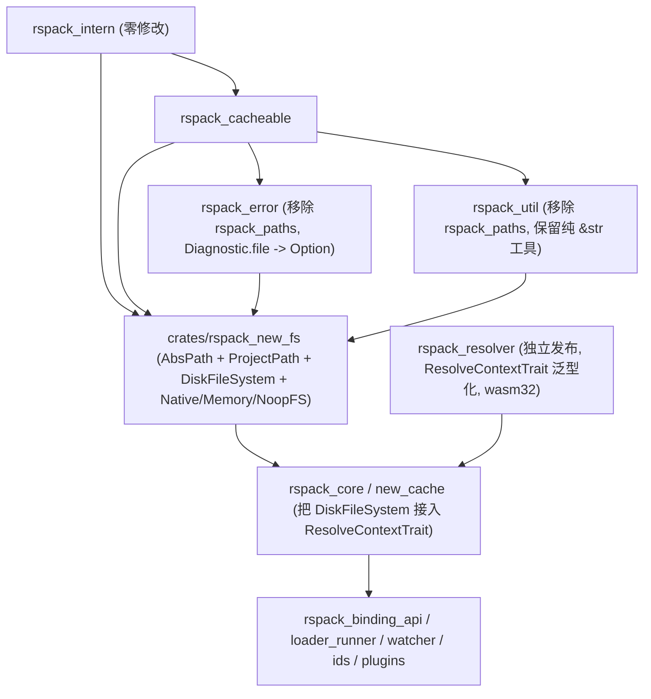
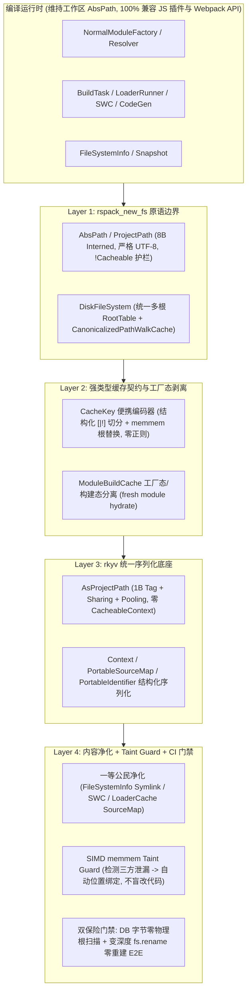

# RFC: Rspack portable 全链路路径可移植性与 `rspack_new_fs` 底层原语设计

| 项目           | 内容                                                                                                                                                          |
| -------------- | ------------------------------------------------------------------------------------------------------------------------------------------------------------- |
| **状态**       | Draft                                                                                                                                                         |
| **目标范围**   | `crates/rspack_new_fs`、`crates/rspack_core/src/new_cache/`、配置层 `roots`、`crates/rspack_resolver` 解耦、`crates/rspack_error` & `crates/rspack_util` 清理 |
| **关联背景**   | Git Worktree 持久化缓存共享、CI 跨机缓存复用、UTF-8 路径彻底收口                                                                                              |
| **兼容性策略** | 新建独立 crate `rspack_new_fs`，渐进式替换，迁移期间与 `rspack_paths` / `rspack_fs` / `legacy_cache` 零破坏共存                                               |

---

## 一、背景与动机（Motivation）

### 1.1 业务驱动：从“单目录持久化”到“跨路径、多 Worktree 复用”

Rspack 正在推进全新一代持久化缓存架构 `new_cache`（见 `.agents/CACHE_AND_INCREMENTAL.md`）。在现代研发工作流中，持久化缓存必须突破“绑定单一固定绝对路径”的限制，重点服务两类高频场景：

1. **Git Worktree 与多 Agent 并行工作流**：
   - 开发者或自动化 Agent 使用 `git worktree add` 同时检出多个分支（可能是兄弟目录 `/repo-main` 与 `/repo-wt1`，也可能是嵌套子目录 `/repo` 与 `/repo/.worktrees/wt1`）。
   - 新建 worktree 的本地工作区路径不同，但绝大部分源码、配置文件与依赖均未改变。如果缓存键、缓存值和快照依赖物理绝对路径，新 worktree 的命中率将直接跌至 **0%**。
2. **CI 跨机 / 跨目录缓存复用与仓库搬迁**：
   - CI runner 的工作目录往往随 runner ID 或容器挂载点变化（如 `/runner/1/repo` vs `/runner/2/repo`），本地仓库目录重命名或迁移也会改变物理前缀。

### 1.2 为什么必须从 0 设计，彻底抛弃 `legacy_cache` 的旧方案？

`legacy_cache` 曾经通过 `rspack_cacheable` 里的 `PortablePath`（`crates/rspack_cacheable/src/utils/portable_path.rs`）和 `PortableString`（`crates/rspack_cacheable/src/utils/portable_string.rs`）提供过可移植能力，但其底层假设存在结构性缺陷，**绝不能延续到 `new_cache`**：

1. **单一 `project_root` 与根外路径转 `../` 的深度陷阱**：
   - 旧 `PortablePath` 和 `PortableString` 对 `project_root` **之外** 的路径也统一计算 `../` 相对路径（如 `<project_root>/../other/lib/`）。
   - 在 **变深度嵌套 worktree**（`/repo` 与 `/repo/.worktrees/wt1` 相差 2 级目录）中，主仓指向外层共享 pnpm store 或兄弟包时记录的 `../../store/...`，在嵌套 worktree 反序列化后会拼接到完全错误的路径，导致缓存直接损坏或错读。
2. **`PortableString` 的盲正则脆弱性与性能开销**：
   - `PATH_REGEX`（`crates/rspack_cacheable/src/utils/portable_string.rs:8-29`）仅凭正则启发式匹配路径，存在大量已知 Bug：
     - 字符集 `[^/\\ \t\n\r?=,;:#&|!]` 遇到**含空格的目录名**立即截断；
     - 要求路径段以分隔符结尾，**无尾斜杠的独立目录路径**无法按目录匹配；
     - 会误匹配 `ContextModule` 中的**正则表达式片段**（如 `|/foo/`）以及 URL（`https://...`）；
     - Windows 正则只匹配 `[a-zA-Z]:\\...`，漏掉正斜杠 `C:/...` 与 DOS 设备前缀 `\\?\C:\...`。
3. **只覆盖序列化 Value，不覆盖 Cache Key 与 Etag**：
   - 旧设计只在 `CacheCodec` 编解码 Value 时做转换；而 `new_cache` 基于 Key-Value 查找（`TurboDatabase` 直接按 UTF-8 `CacheKey` 字节寻址），Key 中只要带绝对路径，连读取反序列化的机会都没有（100% miss）。
4. **`NormalModule` 全量序列化导致路径表面积过大**：
   - `legacy_cache` 跳过 `FactorizeTask` 并序列化整个 `ModuleGraph`，导致 `NormalModule` 携带的 15+ 工厂态字段与配置对象全部暴露在缓存中；而 `new_cache` 的 `BuildTask` 已经先 factorize 出新模块，具备更优雅的架构空间。

### 1.3 顺带收口的两项历史技术债

借本次 `new_cache` 从零重构底层原语的契机，一并解决以下两项长期遗留问题：

1. **彻底完成 UTF-8 路径收口**：此前 Rspack 引入 `camino` 做过一轮迁移但并不彻底，至今仍有 `InternedPath` 持有非 UTF-8 `&Path`、`OsStr::as_encoded_bytes()` 裸字节序列化、以及散落各处的 `.assert_utf8()` panic 与 `.to_string_lossy()` 静默路径损坏。新原语层**从入口拒绝非 UTF-8 路径**，全链路只流通合法 UTF-8。
2. **用独立 `crates/rspack_new_fs` 渐进替代旧 crates**：同时新建一套干净的 `paths` + `fs` 原语库，迁移期内与 `rspack_paths`、`rspack_fs` 和 `legacy_cache` 完全共存、零兼容性破坏，全部替换完成后再统一清理旧代码。

---

## 二、业界方案横向调研与关键启示（Prior art）

为了确保从零设计的方案处于工程最优解，调研了 **Turbopack（Next.js）**、**Parcel v2**、**Webpack**、**Buck2 / Bazel** 以及 **ccache / sccache / rustc** 的源码与缓存机制。

### 2.1 横向对比矩阵

| 工具                         | 路径抽象模型                                                                                                                                              | 根外路径 / 全局 Store 处理                                                                                 | 转换时机                                                         | 持久化缓存可移植性                                        | 最核心借鉴 / 避坑点                                                                                                                                                         |
| ---------------------------- | --------------------------------------------------------------------------------------------------------------------------------------------------------- | ---------------------------------------------------------------------------------------------------------- | ---------------------------------------------------------------- | --------------------------------------------------------- | --------------------------------------------------------------------------------------------------------------------------------------------------------------------------- |
| **Turbopack**                | 内核全量使用 `FileSystemPath { fs: ResolvedVc<FS>, path: RcStr }`（纯 POSIX 相对路径）                                                                    | **多逻辑根** `DiskFileSystemMap`（`project`、`output`、`gvs` pnpm 全局虚拟存储、`@extra`），严禁 `..` 逃逸 | 内核无绝对路径，仅在 OS I/O 与 Node Worker IPC 边界转 `sys_path` | **已支持（>99% 复用）**，CI 用 `fs.rename` 实测守护       | **借鉴**：多逻辑根模型、逻辑身份与物理路径解耦、跨根软链缓存、`fs.rename` 重定位门禁                                                                                        |
| **Parcel v2**                | 内核使用 Flow 不透明类型 `ProjectPath`（POSIX 相对路径）                                                                                                  | **根外强制保留绝对路径（拒绝 `../`）**                                                                     | 仅在 Public Facade / Plugin 边界实时转换；序列化层路径无关       | **已支持**，并用 `assertNoFilePathInCache` 扫描字节防泄漏 | **借鉴**：根外绝不转 `../` 兜底、缓存防泄漏扫描、SWC/CSS 内容主动去路径化<br>**避坑**：无标签字符串混存相对与绝对路径导致 5 类真实 Bug；未 `realpath` 根路径导致 macOS 失效 |
| **Webpack**                  | 内核全链路使用 OS 绝对路径；仅产物/ID/SourceMap 使用 `makePathsRelative`                                                                                  | `path.relative`（产生 `../`），跨盘符保留绝对路径                                                          | 仅输出与 ID 阶段；**持久化缓存层零调用**                         | **不支持**（移动目录即失效或 100% miss）                  | **借鉴**：`NormalModule` 工厂态与构建态彻底分离（`updateCacheModule`）；`[                                                                                                  | !]` 结构化切分；`webpack://./...` SourceMap |
| **Buck2 / Bazel**            | **强类型分层**：Buck2 `CellPath` / `ProjectRelativePath` / `ForwardRelativePath`（禁 `..` 与 `\`）/ `AbsNormPath`；Bazel `RootedPath(Root, PathFragment)` | 多 Cell 命名空间（`cell//rel`）或独立逻辑 `Root`                                                           | **编译期类型隔离**：`AbsNormPath` 无法进入 Action Cache Key      | **架构级原生支持**（本地 + REAPI 远程缓存）               | **借鉴**：利用 Rust 类型系统在编译期拦截未转换绝对路径进入缓存                                                                                                              |
| **ccache / sccache / rustc** | 编译器原生路径 + 缓存层 **`basedirs` 多前缀映射** + `-ffile-prefix-map` / `--remap-path-prefix` / `trim-paths`                                            | 多 `basedirs` 列表匹配；未命中保持原样                                                                     | 哈希前前缀重写 + 编译期调试路径剥离                              | **配置级支持**                                            | **借鉴**：多根前缀映射 + **“只改 Key 不净化产物必然中毒”**                                                                                                                  |

### 2.2 各工具源码级深度启示

#### （1）Turbopack（`vercel/next.js`）：多逻辑根与重定位验证

- **严格规范化的相对路径**：`FileSystemPath`（`turbopack/crates/turbo-tasks-fs/src/path.rs:25-30`）绑定逻辑 `fs` 与纯 POSIX 相对 `RcStr`；`normalize_path`（`turbopack/crates/turbo-unix-path/src/lib.rs:66-80`）统一 `/` 分隔、禁止 `..` 逃逸根目录。
- **多根非重叠表与 pnpm GVS**：通过 `DiskFileSystemMap`（`turbopack/crates/turbo-tasks-fs/src/fs_map.rs:17-109`）管理互不重叠的逻辑根（含 `crates/next-api/src/additional_roots.rs:28-368` 的 `@<key>` 命名根与 `turbopack-nodejs/src/global_virtual_store.rs` 自动探测的 pnpm `gvs` 根），并通过 `CanonicalizedPathWalkCache` 处理指向外部根的软链祖先。
- **Loader 边界约束**：Node.js Worker 通过 `EvaluateArg::Path(FileSystemPath)` 延迟转换，同 FS 优先传相对路径（`turbopack/crates/turbopack-node/src/evaluate.rs:48-85`），回传依赖一律转回 `FileSystemPath`（`transforms/webpack.rs:246-277`），SourceMap 立即归一化为 `turbopack:///[fs]/<rel>`。
- **CI 防退化测试**：`test/e2e/app-dir/turbopack-portable-build-cache/turbopack-portable-build-cache.test.ts` 直接 `fs.rename` 整个工程（含 `.next/cache/turbopack`），断言第二次构建解析、编译、分块、codegen 执行次数均为 0。

#### （2）Parcel v2（`parcel-bundler/parcel`）：根外兜底与必须规避的 5 类 bug

- **根外保绝对原则**：`toProjectPath`（`packages/core/core/src/projectPath.js:11-34`）明确规定——当文件位于 `projectRoot` 之外时**保留规范化绝对路径，绝不生成 `../`**，避免目录重定位后引用失效。
- **内容主动净化 + 磁盘扫描门禁**：Rust SWC Transformer 主动剥离 `project_root`（`packages/transformers/js/core/src/lib.rs:264-269`），CSS Transformer 传入相对路径（`packages/transformers/css/src/CSSTransformer.js:132-135`），测试框架通过 `assertNoFilePathInCache`（`packages/core/test-utils/src/utils.js:1262-1315`）扫描持久化缓存断言不含物理 `projectRoot`。
- **Parcel 源码中暴露的 5 个经典反面教材**（全部源于无标签字符串混存相对与绝对路径）：
  1. `relative.startsWith('..')` 误判 `<projectRoot>/..foo.js` 为外部路径（`projectPath.js:21`）；
  2. 相对化快路径 `to.startsWith(from + '/')` 跳过 `..` 规范化，导致 `/proj/a/../../outside` 逃逸（`packages/core/utils/src/path.js:43-45`）；
  3. 多处将可能是外部绝对路径的 `ProjectPath` 直接传给 `path.join(projectRoot, p)`，拼出 `/proj/outside/index.js` 错误路径（`requests/PathRequest.js:279-282`）；
  4. `invalidateFileNameNode` 混用相对与绝对 `ProjectPath` 做目录比较（`RequestTracker.js:794-826`）；
  5. `resolveOptions` 未对 `projectRoot` 做 `realpath`，而 `parcel-resolver` 始终 canonicalize（`crates/parcel-resolver/src/lib.rs:1213-1218`），在 macOS `/tmp` → `/private/tmp` 等软链根场景下前缀失配，全部退化为绝对路径。

#### （3）Webpack（`webpack/webpack`）：不支持缓存重定位，但有关键结构设计值得借鉴

- **现状确认**：`lib/cache/`、`lib/serialization/`、`lib/fs/FileSystemInfo.js` 中对 `makePathsRelative` / `contextify` 调用次数为 0；`PackFileCacheStrategy` 持有 `this.context` 但从未传入 `fileSerializer`（`lib/cache/PackFileCacheStrategy.js:1266, 1348-1357, 1711-1719`），持久化缓存跨目录无法复用。
- **核心借鉴**：`NormalModule.serialize`（`lib/module/NormalModule.js:2345-2394`）**完全不序列化** `request`、`userRequest`、`rawRequest`、`resource`、`loaders`、`matchResource`、`resourceResolveData`、`parser`、`generator`、`resolveOptions`，命中缓存后通过 `cacheModule.updateCacheModule(freshModule)`（`lib/module/NormalModule.js:966-989`）直接从新 factorize 的模块回填。

---

## 三、Rspack `new_cache` 全链路路径现状审计

经逐文件审计 `crates/rspack_core/src/new_cache/` 及其全部 7 个活跃消费者，当前 `new_cache` 在路径可移植性上的缺口汇总如下表：

| 层次 / 消费者                    | Cache Key & Etag 中的路径泄漏                                                                                                                                                               | Cached Value & Snapshot 中的路径泄漏                                                                                                                                                                                                                                                                                                                                                                                                                      | 关键源码位置                                                                                                                                                                                                                                                  |
| -------------------------------- | ------------------------------------------------------------------------------------------------------------------------------------------------------------------------------------------- | --------------------------------------------------------------------------------------------------------------------------------------------------------------------------------------------------------------------------------------------------------------------------------------------------------------------------------------------------------------------------------------------------------------------------------------------------------- | ------------------------------------------------------------------------------------------------------------------------------------------------------------------------------------------------------------------------------------------------------------- |
| **底层设施与序列化**             | ① `create_cache()` 与 `create_loader_cache()` 硬编码 `CacheCodec::new(None)`<br>② `TurboDatabase` 按裸 UTF-8 `CacheKey` 字节存取<br>③ 子编译器 `compilerPath` 拼入未相对化的 `compilerName` | ① `AsInternedPath` 直接写 `OsStr::as_encoded_bytes()` 裸字节，完全忽略 `ContextGuard`<br>② 旧 `PortablePath`/`PortableString` 仅覆盖零星 6 个点位，且缺 `Context`、`CacheableSource`、Loader 选项等关键类型                                                                                                                                                                                                                                               | `crates/rspack_core/src/new_cache/mod.rs:62`<br>`crates/rspack_core/src/new_cache/loader_cache.rs:149`<br>`crates/rspack_core/src/new_cache/db/turbo.rs:165-185`<br>`packages/rspack/src/Compiler.ts:737-747`<br>`crates/rspack_paths/src/cacheable.rs:18-69` |
| **1. `CacheValidator` & `Meta`** | 子编译器 `compiler_path`                                                                                                                                                                    | ① `configured_build_dependencies` 启动时直接用 `!=` 比较绝对 `InternedPathSet`，路径一变直接 `database.reset()` 清库<br>② `build_dependencies` 与 `build_dependencies_snapshot` 全为绝对路径<br>③ `FileSystemInfo::context_value` / `read_context` 对目录内软链解析后的**绝对目标路径**做哈希                                                                                                                                                             | `crates/rspack_core/src/new_cache/validator.rs:14-20,109-115`<br>`crates/rspack_core/src/new_cache/snapshot/file_system_info.rs:703-757`<br>`crates/rspack_core/src/new_cache/snapshot/mod.rs:63-80`                                                          |
| **2. `ModuleBuildCache`**        | Key = `module.identifier()`（含 loader 与 resource 绝对路径）                                                                                                                               | 直接序列化整棵 `NormalModule`/`ContextModule`：<br>① 15+ 工厂字段（`context`、`request`、`user_request`、`raw_request`、`ResourceString::Explicit`、`ResourceData.context`、`SwcLoader.raw_options`、`loader_options`、`ContextModuleOptions.{addon, context_options, resolve_options}`）<br>② `Dependency` 中的 `Context`、`ContextOptions`、`CssDependency`<br>③ `build_info.{dependencies, snapshot, value_dependencies, extras}` 与 `Diagnostic` 文本 | `crates/rspack_core/src/compilation/build_module_graph/module_build_cache.rs:49-50,137`<br>`crates/rspack_core/src/normal_module.rs:95-151`<br>`crates/rspack_core/src/options/context.rs:16-19`                                                              |
| **3. `CodeGeneration`**          | Key 含裸 `job.module`；Etag `job.hash` 在 `is_commonjs_external` 时直接哈希裸 `module_identifier`，或间接哈希含路径的 `build_info.hash`                                                     | `RawModule::code_generation` 给 `OriginalSource` 传入裸 `identifier`；`CodeGenerationDataConcatenationScopeOutput.refs`；SWC dev 模式可能向生成代码注入绝对路径                                                                                                                                                                                                                                                                                           | `crates/rspack_core/src/compilation/code_generation/mod.rs:195-198`<br>`crates/rspack_core/src/chunk_graph/chunk_graph_module.rs:375`<br>`crates/rspack_core/src/raw_module.rs:121`                                                                           |
| **4. `ResolverCache`**           | `FxHasher(options_key, path, request)` 三项全含绝对路径（`options_key` 哈希 `Resolve.{alias, fallback, tsconfig, modules, roots, restrictions}`）                                           | `CachedResolution.{result, dependencies, snapshot}` 全含绝对 `InternedPath` 与 `NotFound(String)`                                                                                                                                                                                                                                                                                                                                                         | `crates/rspack_core/src/resolver/resolver_cache.rs:75-82`<br>`crates/rspack_core/src/resolver/resolver_impl.rs:130-163`                                                                                                                                       |
| **5. `LoaderCache`**             | Key 哈希裸 `module_identifier` + `loader_name`；Etag 哈希裸 `existing.{file, build}` + `options_cache_key`；且**跨多编译器共享单库**，没有单一 `options.context`                            | ① `source_map` 在 `contextify_source_map` **之前**直接落盘原始 JSON（`SwcLoader`/`LightningCssLoader` 刚将 `sources` 绝对化）<br>② `SwcLoader` 传入绝对 `FileName::Real`，在 `rsc_transform` 与 dev JSX `__source.fileName` 泄漏绝对路径<br>③ `dependency_snapshot` 含绝对 `InternedPath`                                                                                                                                                                 | `crates/rspack_core/src/loader/loader_cache.rs:21-71,159-169`<br>`crates/rspack_loader_swc/src/lib.rs:125,204-218,278-296`                                                                                                                                    |
| **6. `Devtool`**                 | Key 仅含相对 asset 名，未区分 `[absolute-resource-path]` / `output_path` / 自定义模板                                                                                                       | `CachedSourceMapDevToolPluginEntry` 在非默认模板下会把绝对路径/跨根相对路径写进 `sources` 与内联 base64 `asset_append`                                                                                                                                                                                                                                                                                                                                    | `crates/rspack_plugin_devtool/src/source_map_dev_tool_plugin.rs:459-511`<br>`crates/rspack_core/src/cache/cache_entry.rs:27-32`                                                                                                                               |
| **7. `Minimize`**                | `options_hash` 含 `test`/`include`/`exclude` 中的路径字符串                                                                                                                                 | 上游 JS 若已完成路径剥离则内容天然便携                                                                                                                                                                                                                                                                                                                                                                                                                    | `crates/rspack_plugin_swc_js_minimizer/src/lib.rs:273-277,573-587`                                                                                                                                                                                            |

---

## 四、设计原则、目标与非目标（Goals & Non-Goals）

### 4.1 设计目标与核心不变量

1. **全链路严格 UTF-8**：所有新路径类型与新 FS 接口底层均为合法 UTF-8。非 UTF-8 路径在 OS 边界直接返回明确错误，消灭 `.assert_utf8()` panic 与 `.to_string_lossy()` 静默损坏。
2. **所有路径原生 Interned 且极简类型系统**：只保留 `AbsPath` 与 `ProjectPath` 两个 8 字节 `InternedSlice` Owned 类型（**去掉一切 `*Ref` 借用 DST 类型**），保持 O(1) clone、指针 `==` 与 `IdentityHasher` 零重算哈希；相比旧 `InternedPath`，因剥离了重复根前缀，内存占用净降。
3. **`rspack_intern` 零修改**：通过统一多根 2 态字节编码，使 Header 标签（`root_len`）严格成为 `items` 字节的纯函数，直接复用 `SliceInternable::eq(a, b)` 契约，零哈希碰撞风险。
4. **内部统一多根模型，配置驱动**：`DiskFileSystem` 与 `ProjectPath` 内部**不区分 `projectRoot`、`gvs` 与 `additionalRoots`**，统一建模为扁平的 `roots: Vec<(String, AbsPath)>`；默认 `project` 根、pnpm GVS 自动探测与用户 `additionalRoots` 全部在上层 `packages/rspack/src/config/defaults.ts` 汇聚，内核零包管理器耦合。
5. **根外绝对路径兜底（Parcel 语义）**：命中任何已注册 root（含 logical 与 canonical 双前缀）转换为 `Anchored`；未命中任何 root 保留规范化 `External` 绝对路径，**绝不生成 `../../`**。
6. **编译期防泄漏护栏 + 序列化零上下文**：只有 `ProjectPath` 实现 `#[cacheable]`，`AbsPath` **刻意不实现 `#[cacheable]`**。未转换为 `ProjectPath` 的路径在编译期无法写入持久化缓存结构；`ProjectPath` 自带 `rkyv` 编解码，彻底淘汰 `CacheableContext::project_root()`。
7. **基础库依赖干净无环**：`rspack_error`、`rspack_util`、`rspack_resolver` **绝不依赖 `rspack_new_fs`**；由 `rspack_new_fs` 向下依赖 `rspack_intern`、`rspack_error`、`rspack_util` 和 `rspack_cacheable`。
8. **`new_cache` 单一 Always-Portable 格式**：遵守 `.agents/CACHE_AND_INCREMENTAL.md` 原则，不维护便携/非便携双磁盘格式。

### 4.2 非目标（Non-Goals）

- **不改造 `legacy_cache`**：`legacy_cache` 与旧 `rspack_paths`/`rspack_fs` 维持原状直至整体退场。
- **不在编译运行时强行重写全仓库内部路径表示**：`NormalModule`、`LoaderContext`、NAPI 在编译内存中仍使用当前工作区的 `AbsPath`（通过 `DiskFileSystem` 在边界双向转换），保证 100% Webpack/JS 插件与 Loader 生态兼容。
- **不对未知第三方 JS Loader / Plugin 的编译代码做盲目字符串替换**：内容不可控的三方产物泄漏通过「SIMD `memmem` Taint Guard」精确检测并自动降级为位置绑定，绝不破坏用户代码语义与 SourceMap 映射。
- **不直接决定 Git Worktree 的 DB 存储拓扑与 dev `mtime` 校验策略**：本 RFC 解决路径可移植性前置硬阻塞，与后续的 DB 拓扑（Read-only Base + Local Overlay / CoW Fork）及 Git-aware 快照校验保持完全正交。

---

## 五、Crate 分层、依赖解耦与目录结构

### 5.1 全局无环依赖拓扑



### 5.2 前置解耦三个基础 Crate

1. **`rspack_error`（摘除 `rspack_paths`）**：
   - 全 crate 唯一引用在 `crates/rspack_error/src/diagnostic.rs:21`：`pub file: Option<Utf8PathBuf>`。
   - 全仓库全部 7 个赋值点传入的均为输出产物名或 JS `WebpackError.file: string`。直接改为 `pub file: Option<String>`（同时移除 `AsOption<AsPreset>`），即可彻底删除 `rspack_error/Cargo.toml` 中的 `rspack_paths` 依赖。
2. **`rspack_util`（摘除 `rspack_paths`）**：
   - 仅 `crates/rspack_util/src/identifier.rs:7-9`（`dos_device_path_prefix_len` 与 `Utf8Path`）和 `crates/rspack_util/src/node_path.rs:3` 使用了 `rspack_paths`。
   - 将 `dos_device_path_prefix_len` / `strip_dos_device_path_prefix`（纯 ASCII `&str` 切片函数）沉淀到 `rspack_util` 中供基础层使用；`node_path.rs` 过渡期直接引用 workspace 中的 `camino`（待全仓库 7 个调用方切完 `AbsPath::join` / `DiskFileSystem::join` 后可整体移除），彻底移除 `rspack_util/Cargo.toml` 中的 `rspack_paths` 依赖。
3. **`rspack_resolver`（彻底独立 + 渐进过渡）**：
   - `rspack_resolver` 需支持外部独立发布与 `wasm32-unknown-unknown` 编译（如 `crates/rspack_resolver/Cargo.toml:34` 注释所要求），**绝不引入 `rspack_new_fs`**。
   - 只需内联 10 行的 `dos_device_path_prefix_len`（`specifier.rs:4`）和 5 行 `FxHasher`（`cache.rs:47`），并新增一个轻量的 UTF-8 依赖收集 trait：
     ```rust
     pub trait ResolveContextTrait: Send {
       fn add_file_dependency(&mut self, path: &Utf8Path);
       fn add_missing_dependency(&mut self, path: &Utf8Path);
     }
     ```
   - `ResolverGeneric<Fs>` 与 `Cache<Fs>` **无需新增泛型参数**，仅将 `resolve_with_context` / 内部解析路径泛化到 `C: ResolveContextTrait`（无追踪的 `resolve()` 走零成本 `NoopResolveContext` 内联消除）。
   - **过渡期兼容性保留**：`crates/rspack_resolver/src/cache.rs:182` 上私有的 `package_json_dep_path: OnceLock<InternedPath>`、默认 `ResolveContext` 以及 `crates/rspack_resolver/src/tests/` 下 8 个单测暂保持不变（`package_json_dep_path` 返回 `&Utf8Path` 给 `ResolveContextTrait`）；待 Phase 4 最终删除 `rspack_paths` 时，再将其一键换为 `OnceLock<Box<Utf8Path>>` 与 `FxHashSet<Utf8PathBuf>` 并移除 `rspack_paths` 依赖。

### 5.3 `crates/rspack_new_fs` 目录结构与 `Cargo.toml`

`crates/rspack_new_fs` 采用**「Phase 0 极简核心 + 后续按接入阶段按需扩充」**策略：Phase 0 仅落地最小可 review 的核心原语与只读门面壳，避免提前堆砌未接入代码；其余 FS 实现、辅助方法与缓存结构随 Phase 1–3 接入时按需补充。

Phase 0 `Cargo.toml` 仅引入最小依赖（`async-trait`、`rspack_cacheable`、`rspack_error`、`rspack_intern`、`rspack_util`、`rustc-hash`、`smallvec`、`ustr`，`[dev-dependencies]` 仅保留 `tokio`），无需拆分 `fs` feature，仅保留可选 `allocative` feature；`dashmap`、`indexmap` 等依赖待后续阶段按需加入：

```text
crates/rspack_new_fs/
├── Cargo.toml
├── src/
│   ├── lib.rs                 # [Phase 0 已落地] 导出核心原语（AbsPath / ProjectPath / DiskFileSystem / RootTable / Traits / Error）
│   ├── error.rs               # [Phase 0 已落地] Error + From<Error> for rspack_error::Error（Io / NonUtf8Path / NotAbsolutePath / PathEscapesRoot / InvalidRootName / UnknownRoot / OverlappingRoot）
│   ├── path/
│   │   ├── mod.rs             # [Phase 0 已落地] 导出 AbsPath / ProjectPath / ProjectPathParts / AsProjectPath / IdentityHasher / 基础 Map & Set
│   │   ├── normalize.rs       # [Phase 0 已落地, pub(crate)] 纯 UTF-8 词法规范化（零 unsafe，Unix & Windows \\?\ / 盘符 / UNC / POSIX rel）
│   │   ├── abs_path.rs        # [Phase 0 已落地] AbsPath (8B InternedSlice, 严格 UTF-8, !Cacheable)
│   │   ├── project_path.rs    # [Phase 0 已落地] ProjectPath (8B InternedSlice, Anchored | External)
│   │   ├── cacheable.rs       # [Phase 0 已落地] AsProjectPath（零上下文 rkyv Sharing + Pooling + 字节校验）
│   │   └── path_list.rs       # [Phase 2 按需补充] ProjectPathList（弱引用 DashMap 内容去重列表）
│   └── fs/
│       ├── mod.rs             # [Phase 0 已落地]
│       ├── traits.rs          # [Phase 0 已落地] FileMetadata + 极简只读 ReadableFileSystem（Phase 1 按需补读方法；Phase 3 扩 Writable/Intermediate）
│       ├── root_table.rs      # [Phase 0 已落地] RootTable（统一多根表：logical + canonical 双前缀、非重叠校验、最长匹配）
│       ├── disk_fs.rs         # [Phase 0 已落地] DiskFileSystem 极简只读门面（Phase 2 按需补 read_link / read_dir_paths / relative 等）
│       ├── native_fs.rs       # [Phase 1 按需补充] NativeFileSystem（全 AbsPath + 严格 UTF-8 拒绝；Phase 1 落只读，Phase 3 补写侧）
│       ├── memory_fs.rs       # [Phase 1 按需补充] MemoryFileSystem（全 AbsPath，复用 rspack_util；Phase 1 落只读，Phase 3 补写侧）
│       ├── canonical_cache.rs # [Phase 2 按需补充] CanonicalizedPathWalkCache（外部软链祖先 canonicalize 缓存）
│       ├── metadata.rs        # [Phase 3 按需补充] 独立 FileMetadata / FilePermissions
│       ├── writable_disk_fs.rs# [Phase 3 按需补充] WritableDiskFileSystem（共享 Arc<RootTable>，适配独立 outputFileSystem）
│       └── noop_fs.rs         # [Phase 3 按需补充] NoopFileSystem
└── tests/
    └── basic.rs               # [Phase 0 已落地] 词法边界、多根表、DiskFileSystem 基础操作、AsProjectPath 损坏字节安全测试
```

---

## 六、底层路径原语详细设计（`rspack_new_fs::path`）

### 6.1 为什么去掉所有 `XxxPathRef`？

标准库区分 `PathBuf` 与 `Path`，是因为 `PathBuf` 独占堆内存、`clone()` 会触发堆分配，且 `parent()` 等视图需要借用切片。但在 `rspack_new_fs` 中，`AbsPath` 与 `ProjectPath` 均是基于 `InternedSlice`（`triomphe::ThinArc`）的 **8 字节薄指针**：

- `&AbsPath` / `&ProjectPath` 仅 8 字节，比 `&Path` / `&XxxPathRef` 的 16 字节胖指针更小；
- `clone()` 仅为一次原子引用计数加一（零堆分配）；
- 拆解视图直接用栈上枚举 `ProjectPathParts<'a>` 返回 `&'a str`，完全避免引入第二套 `*Ref` DST 类型与转换心智负担。

### 6.2 `AbsPath` 设计（OS / JS / NAPI 边界唯一绝对路径类型）

**核心不变量：**

- **严格 UTF-8**：所有字节保证为合法 UTF-8。
- **必须为绝对路径**：Unix 必须以 `/` 开头；Windows 必须为盘符绝对路径（`X:\...` 或 `X:/...`）或 UNC 路径（`\\server\share...`）。相对路径、纯盘符工作目录相对路径（`C:foo`）等一律返回 `Err(Error::NotAbsolutePath)`。
- **构造期完成跨平台词法规范化**：
  - Windows：剥除 `\\?\` 与 `\\?\UNC\` 设备前缀（`\\?\C:\a` → `C:\a`、`\\?\UNC\server\share\a` → `\\server\share\a`）；将 `/` 统一转为 `\`；将 ASCII 盘符大写（`c:\foo` → `C:\foo`）。
  - 全平台：折叠连续分隔符（`a//b` → `a/b`，保留 Windows UNC 开头 `\\`）、消除 `.` 段、按组件弹出 `..`（越过根目录 `/` 或 `C:\` 时停在根部，符合 OS 语义）、去掉末尾多余分隔符（根自身 `/`、`C:\`、`\\server\share\` 除外）。
- **O(1) 字节等价带来的直接收益**：因为构造期已做规范化，Windows 上不再需要像旧 `PreHashedPath::eq`（`crates/rspack_paths/src/lib.rs:134-145`）那样回退调用 `Path::eq`，全平台统一快速字节 `==` 与 `FxHash`！
- **编译期防泄漏**：`AbsPath` **不实现 `rkyv::Archive` / `Cacheable`**。

```rust
#[derive(Clone, PartialEq, Eq)]
pub struct AbsPath(InternedSlice<AbsPathInner>); // size_of == 8 bytes

impl AbsPath {
  // === Phase 0 已落地核心方法 ===
  pub fn new(raw: &str) -> Result<Self>;
  pub fn try_from_std_path(path: &Path) -> Result<Self>; // 非 UTF-8 -> Err(Error::NonUtf8Path)

  #[inline] pub fn as_str(&self) -> &str;
  #[inline] pub fn as_std_path(&self) -> &Path { Path::new(self.as_str()) }
  #[inline] pub fn precomputed_hash(&self) -> u64 { *self.0.header() }

  pub fn parent(&self) -> Option<AbsPath>;
  /// 词法拼接并规范化（自动处理 sub 为相对或绝对的情况）
  pub fn join(&self, sub: &str) -> Result<AbsPath>;
  /// 严格组件边界前缀剥离：返回 OS 原生剩余后缀（"" 表示与 base 相等）
  /// 保证 `/repo/app` 绝不误匹配 `/repo/app-2`
  pub fn strip_prefix(&self, base: &AbsPath) -> Option<&str>;
  // 内部快路径（pub(crate)）：join_normalized_posix_rel 供 RootTable::to_abs_path 零重扫描拼接已规范化 POSIX rel

  // === Phase 2/3 按需补充 ===
  pub fn file_name(&self) -> Option<&str>;
  pub fn extension(&self) -> Option<&str>;
}
```

### 6.3 `ProjectPath` 设计（内核与 `new_cache` 唯一便携路径类型）

`ProjectPath` 采用 **单 8 字节 `InternedSlice` + 紧凑 Header 标签**，内部统一为 **2 态**（不区分主根与附加根）：

```rust
#[derive(Clone, Copy, PartialEq, Eq, Hash)]
pub(crate) struct ProjectPathHeader {
  pub(crate) hash: u64,     // FxHash(items) —— 直接喂给 IdentityHasher
  /// `0` 表示 External（不在任何已注册 root 内，保留规范化 AbsPath 的 UTF-8 字节，绝不转 '../'）；
  /// `1..=254` 表示 Anchored，值为 root_name 字节长度：
  /// - items = "{root}"（rel 为空）或 "{root}/{rel}"
  /// - root: 1..=254 个 ASCII 字符 [a-zA-Z0-9_@-]（不含 '/'、'\'、':'）
  /// - rel: 严格 POSIX '/' 分隔，无前导/尾随 '/'，无 '.' 与 '..' 段
  pub(crate) root_len: u16,
}

/// 8 字节 Interned 二态便携路径，无条件实现 #[cacheable]
#[cacheable(with = super::cacheable::AsProjectPath)]
#[derive(Clone, PartialEq, Eq)]
pub struct ProjectPath(InternedSlice<ProjectPathInner>); // size_of == 8 bytes

#[derive(Clone, Copy, Debug, PartialEq, Eq, Hash)]
pub enum ProjectPathParts<'a> {
  Anchored { root: &'a str, rel: &'a str },
  External(&'a str),
}
```

#### 数学证明：为什么 `rspack_intern` 一行都不用改？

`SliceInternable::eq` 要求 `Header` 必须是 `items` 字节切片的纯函数（`crates/rspack_intern/src/slice.rs:283-285`）。检查 `Anchored` 与 `External` 的 `items` 字节域：

1. **`Anchored` 的字节域**：因校验约束 `root` 必须为非空 ASCII `[a-zA-Z0-9_@-]`，其首字节必属于 `[a-zA-Z0-9_@-]`，且次字节**绝不可能是 `:`**（因此绝不碰撞 Windows `X:\...`）；`items` 中第一个 `/`（若无则为总长）的位置**唯一确定 `root_len`**，而 `rel` 部分（不含 `/` 以外的路径分隔符）也唯一确定。
2. **`External` 的字节域**：源自严格校验过的 `AbsPath`：
   - Unix 下首字节必为 `/`；
   - Windows 下要么首字节为 `\`（UNC 路径 `\\server\...`），要么第 2 个字节为 `:`（盘符路径 `C:\...`）。

**结论**：`Anchored` 与 `External` 的 `items` 字节集合**跨平台严格互斥、交集为空集**；任意两个不同的 `(root_len, items)` 绝不可能拥有相同的 `items` 字节。因此 `SliceInternable::eq(a, b)` 只需 `a == b`，**无需修改 `rspack_intern`**，零哈希碰撞风险，同时 Header 缓存 `root_len` 让 `parts()` 保持 O(1) 无扫描！

#### 为什么 `External` 不设计为 `enum ProjectPath { Anchored(...), Absolute(AbsPath) }`？

1. **8 字节 `ThinArc` 紧凑布局与无分支快路径**：当前 `ProjectPath` 为单指针 8 字节 `InternedSlice`，而包含 `AbsPath` 的公开 `enum` 会膨胀至 16 字节并引入分支判别；统一 8 字节布局让全链路 `clone`、`==`（单指针比较）、`IdentityHasher` 与 `rkyv` `Sharing`/`Pooling` 均保持单路径无分支快路径。
2. **跨 OS `rkyv` 反序列化兼容**：`External` 在归档内以 `tag = 0x00` 存为规范化 UTF-8 字节，解码时不强制立即构建宿主机 `AbsPath`（仅校验格式与 UTF-8 合法性），把“当前宿主机是否可访问该盘符/路径风味”延后到实际 I/O 的 `RootTable::to_abs_path` 检查。
3. **编译期护栏与语义边界分离**：`AbsPath` 代表未锚定的运行时绝对路径且刻意 `!Cacheable`；`ProjectPath::External` 则代表“已通过 `RootTable` 最长前缀匹配、确认不在任何 root 内”的根外缓存态，避免裸 `AbsPath` 绕过前缀锚定直接混入持久化结构。

#### `ProjectPath` 核心方法契约

```rust
impl ProjectPath {
  // === Phase 0 已落地核心方法 ===
  /// 构造 Anchored：校验 root 合法性（1..=254, [a-zA-Z0-9_@-]），
  /// 将 rel 按 POSIX 规则规范化（'\' -> '/'，消除 '.'，折叠内部 '..'，若逃逸出根则返回 Err(PathEscapesRoot)）
  pub fn anchored(root: &str, rel: &str) -> Result<Self>;
  /// 构造 External 兜底
  pub fn external(abs: &AbsPath) -> Self;

  #[inline]
  pub fn parts(&self) -> ProjectPathParts<'_> {
    // SAFETY: `ProjectPath` only ever interns valid UTF-8 bytes.
    let s = unsafe { std::str::from_utf8_unchecked(self.0.items()) };
    let root_len = usize::from(self.0.header().root_len);
    if root_len == 0 {
      ProjectPathParts::External(s)
    } else {
      let rel = if s.len() == root_len { "" } else { &s[root_len + 1..] };
      ProjectPathParts::Anchored { root: &s[..root_len], rel }
    }
  }

  #[inline] pub fn is_external(&self) -> bool { self.0.header().root_len == 0 }
  #[inline] pub fn is_anchored(&self) -> bool { self.0.header().root_len != 0 }
  #[inline] pub fn precomputed_hash(&self) -> u64 { self.0.header().hash }

  /// 同根内快速操作（不依赖 DiskFileSystem；干净 POSIX 相对路径走零解析快路径直接拼接，
  /// 若 sub 为绝对路径或 '..' 逃逸出根返回 None，交由 DiskFileSystem::join 跨根兜底）
  pub fn try_join(&self, sub: &str) -> Option<Self>;
  /// 同根内零拷贝切片计算父目录
  pub fn parent_in_root(&self) -> Option<Self>;

  // === Phase 2 按需补充 ===
  #[inline] pub fn root_name(&self) -> Option<&str>;
  /// read_dir 等单层子项专用：仅允许单路径段（无 '/'/'\'/'.'/'..'），零往返构造成本
  pub fn join_segment(&self, segment: &str) -> Result<Self>;
  pub fn file_name(&self) -> Option<&str>;
  pub fn extension(&self) -> Option<&str>;

  /// 跨平台/跨架构确定性哈希（用于 ResolverCache / LoaderCache / ContextHash，喂给 Xxhash64）
  pub fn stable_hash<H: Hasher>(&self, state: &mut H) {
    let root_len = self.0.header().root_len;
    if root_len == 0 {
      state.write_u8(2);
    } else {
      state.write_u8(1);
      state.write_u16(root_len);
    }
    state.write_u64(self.0.items().len() as u64);
    state.write(self.0.items());
  }

  /// 写入无歧义便携 CacheKey："r:{root}/{rel}" | "r:{root}" | "e:{abs}"
  pub fn write_portable_key(&self, out: &mut String);
  /// 日志与人类可读展示："[project]/src/index.ts" | "[gvs]/..." | "/usr/lib/..."
  pub fn display(&self) -> ProjectPathDisplay<'_>;
}
```

### 6.4 集合类型与 `ProjectPathList`（完整替代 `InternedPath*`）

直接沿用 `crates/rspack_paths/src/lib.rs:302-321` 与 `crates/rspack_paths/src/path_list.rs:34-284` 的 `IdentityHasher` 与弱引用 `DashMap` 去重策略（`handles: AtomicUsize` 归零自动清理回收桶容量）：

```rust
// === Phase 0 已落地 ===
pub type ProjectPathMap<V>      = HashMap<ProjectPath, V, BuildHasherDefault<IdentityHasher>>;
pub type ProjectPathSet         = HashSet<ProjectPath, BuildHasherDefault<IdentityHasher>>;
pub type AbsPathMap<V>          = HashMap<AbsPath, V, BuildHasherDefault<IdentityHasher>>;
pub type AbsPathSet             = HashSet<AbsPath, BuildHasherDefault<IdentityHasher>>;

// === Phase 2/3 按需补充 ===
pub type ProjectPathDashMap<V>  = DashMap<ProjectPath, V, BuildHasherDefault<IdentityHasher>>;
pub type ProjectPathDashSet     = DashSet<ProjectPath, BuildHasherDefault<IdentityHasher>>;
pub type ProjectPathIndexMap<V> = IndexMap<ProjectPath, V, BuildHasherDefault<IdentityHasher>>;
pub type ProjectPathIndexSet    = IndexSet<ProjectPath, BuildHasherDefault<IdentityHasher>>;
pub struct ProjectPathList(Arc<ListStorage<ProjectPath>>);
```

### 6.5 `AsProjectPath` 零上下文 `rkyv` 序列化

`ProjectPath` 自身就是便携表示，因此序列化与反序列化**不再读取 `CacheableContext::project_root()`**：

```text
Wire format (ArchivedRc<ArchivedVec<u8>, AsProjectPath>):
  ┌────────┬────────────────────────────────────────────────────┐
  │ tag:u8 │ items: [u8; N] (strict UTF-8)                      │
  └────────┴────────────────────────────────────────────────────┘
  • tag == 0x00        -> External, items = 规范化 AbsPath UTF-8
  • tag == 0x01..=0xFE -> Anchored { root_len: tag as u16 }, items = "{root}" 或 "{root}/{rel}"（1..=254）
```

- **序列化（`Sharing`）**：按 `ptr::from_ref(field.0.header()).addr()` 归档内去重，每个唯一 `ProjectPath` 在单个 archive 中只写一次，零路径重写成本。
- **反序列化（`Pooling`）**：补齐旧 `AsInternedPath` 缺失的 `rkyv::de::Pooling` 按归档偏移量去重（每个共享路径只重新 intern 一次）；解码时严格校验 `std::str::from_utf8`、`tag` 与 `root_len` 边界及内部字符合法性，**防止损坏的磁盘缓存文件触发任何未定义行为**。

### 6.6 极端边界测试用例矩阵

| 输入路径 / 场景                        | 注册根 `roots`                                                | 预期 `ProjectPath` 结果                             | 说明                                 |
| -------------------------------------- | ------------------------------------------------------------- | --------------------------------------------------- | ------------------------------------ |
| `/repo/.worktrees/wt1/src/index.ts`    | `[("project", "/repo/.worktrees/wt1")]`                       | `Anchored { root: "project", rel: "src/index.ts" }` | 兄弟或嵌套 worktree 编码完全一致     |
| `/repo/.worktrees/wt1`                 | `[("project", "/repo/.worktrees/wt1")]`                       | `Anchored { root: "project", rel: "" }`             | 根本身允许为空 `rel`                 |
| `/repo/..foo.js`                       | `[("project", "/repo")]`                                      | `Anchored { root: "project", rel: "..foo.js" }`     | 消灭 Parcel Bug #1（非 `..` 段）     |
| `/repo/a/../../outside/x.js`           | `[("project", "/repo")]`                                      | `External("/outside/x.js")`                         | 消灭 Parcel Bug #2（先规范化再匹配） |
| `/repo-other/index.ts`                 | `[("project", "/repo")]`                                      | `External("/repo-other/index.ts")`                  | 严格组件边界，不误匹配 `/repo`       |
| `/pnpm-store/v11/links/react/index.js` | `[("project", "/repo"), ("gvs", "/pnpm-store/v11/links")]`    | `Anchored { root: "gvs", rel: "react/index.js" }`   | 多根独立命名，深度变化不影响命中     |
| `/usr/local/lib/helper.js`             | `[("project", "/repo")]`                                      | `External("/usr/local/lib/helper.js")`              | 根外保留绝对路径，绝不生成 `../`     |
| `/private/tmp/repo/src/a.ts` (macOS)   | `[("project", "/tmp/repo")]` (canonical: `/private/tmp/repo`) | `Anchored { root: "project", rel: "src/a.ts" }`     | 双前缀表命中 canonical 根            |
| `\\?\c:\Repo\src\a.ts` (Windows)       | `[("project", "C:\\Repo")]`                                   | `Anchored { root: "project", rel: "src/a.ts" }`     | 剥 `\\?\`、大写盘符、POSIX `rel`     |
| `D:\ext\a.ts` (Windows 跨盘符)         | `[("project", "C:\\Repo")]`                                   | `External("D:\\ext\\a.ts")`                         | 跨盘符自然走 `External` 兜底         |
| 非 UTF-8 `OsString`（Unix 孤立字节）   | 任意                                                          | `Err(Error::NonUtf8Path)`                           | 入口即拒绝，禁止损坏传播             |

---

## 七、`DiskFileSystem` 与统一多根架构（`rspack_new_fs::fs`）

### 7.1 两层架构设计（兼容 JS 注入 FS 与 PnP，按阶段渐进落地）

Rspack 与 Turbopack 的核心差异在于必须支持 JS 侧传入的 `inputFileSystem`（如 `NodeFileSystem`、`MemoryFileSystem`、`HybridFileSystem`、`VirtualFileSystem`）以及 Yarn PnP。因此采用**底层抽象接口 + 上层根感知门面**两层分离，并按阶段渐进落地：

1. **底层 Trait（全面收口 `&AbsPath` / `AbsPath`）**：
   - Phase 0 仅落地只读 `ReadableFileSystem` 与 `FileMetadata`（对应旧 `crates/rspack_fs/src/read.rs`），参数与返回值全部从 `Utf8Path` 统一改为 `AbsPath`（及 `Vec<String>` 保持子项文件名）；
   - Phase 1 先行补齐只读侧 `NativeFileSystem` 与 `MemoryFileSystem`（遇非 UTF-8 路径或文件名返回 `Error::NonUtf8Path`），直接自底向上替换 `input_filesystem`；
   - Phase 3 再按需补齐写侧与中间 FS：`WritableFileSystem`、`IntermediateFileSystem`、`NoopFileSystem`、`FilePermissions` 及写侧原生/内存实现。
2. **上层 `DiskFileSystem` 与 `WritableDiskFileSystem`（全部收发 `ProjectPath`）**：
   - Phase 0 的 `DiskFileSystem` 仅封装 `Arc<dyn ReadableFileSystem>` + `Arc<RootTable>`；
   - Phase 2 接入 `new_cache` 时按需补齐 `CanonicalizedPathWalkCache`、`LinkTarget`、`read_link`、`read_dir_paths` 等高阶接口；
   - Phase 3 再引入共享同一份 `Arc<RootTable>` 的 `WritableDiskFileSystem`，适配 `output_filesystem` 与 `input_filesystem` 为不同实例的场景。

### 7.2 统一 `RootTable`（零主根 / GVS / 附加根特判）

```rust
struct RootEntry {
  name: Box<str>,                 // 如 "project"、"gvs"、"@shared"
  root: AbsPath,                  // 逻辑根（to_abs_path 还原默认使用）
  canonical_root: Option<AbsPath>,// fs.canonicalize(&root) 且不同于 root 时记录（解决 /tmp -> /private/tmp）
}

pub struct RootTable {
  entries: Box<[RootEntry]>,
  /// 将所有 entry 的 root 与 canonical_root 展开并按路径字节长度降序排列
  ///（通常仅 1~6 个前缀，线性扫描一次即可装入 CPU Cache Line）
  prefixes: Box<[(AbsPath, usize)]>,
  by_name: FxHashMap<Box<str>, usize>,
}
```

**初始化校验规则：**

1. 接收扁平的 `Vec<(String, AbsPath)>`：校验每个 `name` 非空、长度 ≤ 254、只含 ASCII `[a-zA-Z0-9_@-]`、且不重名；
2. 尝试通过 `fs.canonicalize` 获取每个 root 的真实路径（目录暂不存在则允许 `canonical_root = None`）；
3. **非重叠校验**：检查任意两条根（含其 `canonical_root`）之间不存在包含关系（`a.strip_prefix(b).is_none()`），防止两个逻辑根互相嵌套导致序列化键出现二义性（发现重叠直接返回 `Error::OverlappingRoot`）；
4. 若传入 `roots` 为空（如极简单元测试），`prefixes` 为空，所有路径自动降级为 `ProjectPath::external`，无需任何特判代码。

### 7.3 `DiskFileSystem` 接口（Phase 0 核心壳 + phase 1/2 按需扩充）

```rust
// Phase 0 极简结构直接持有 fs + roots；Phase 2 引入 CanonicalizedPathWalkCache 时再按需内聚为 Inner
#[derive(Debug, Clone)]
pub struct DiskFileSystem {
  fs: Arc<dyn ReadableFileSystem>,
  roots: Arc<RootTable>,
}

/// [Phase 2 按需补充]
#[derive(Debug, Clone, PartialEq, Eq, Hash)]
pub enum LinkTarget {
  /// 原始软链是相对路径（如 `../../packages/ui`），`resolved` 已通过多根表归一化
  Relative { raw: String, resolved: ProjectPath },
  /// 原始软链是绝对路径，`resolved` 已通过多根表映射（或兜底 External）
  Absolute { resolved: ProjectPath },
}

impl DiskFileSystem {
  // === Phase 0 已落地核心接口 ===
  pub fn new(fs: Arc<dyn ReadableFileSystem>, roots: Vec<(String, AbsPath)>) -> Result<Self>;
  pub fn from_root_table(fs: Arc<dyn ReadableFileSystem>, roots: Arc<RootTable>) -> Self;
  pub fn roots(&self) -> &Arc<RootTable>; // RootTable 已提供 root_names() / root_abs_path(name)
  pub fn backend(&self) -> &Arc<dyn ReadableFileSystem>;

  // 路径转换
  pub fn to_project_path(&self, abs: &AbsPath) -> ProjectPath;
  pub fn to_project_path_str(&self, raw: &str) -> Result<ProjectPath>;
  pub fn to_abs_path(&self, path: &ProjectPath) -> Result<AbsPath>;

  // 跨根安全路径计算
  /// 优先零开销走 ProjectPath::try_join（99.9% 同根场景）；
  /// 仅当 '..' 逃逸出当前根或 sub 为绝对路径时，经 to_abs_path -> AbsPath::join -> to_project_path 兜底
  pub fn join(&self, base: &ProjectPath, sub: &str) -> Result<ProjectPath>;
  pub fn parent(&self, path: &ProjectPath) -> Result<Option<ProjectPath>>;

  // 文件系统基础读操作（入参出参全部为 ProjectPath）
  pub async fn read(&self, path: &ProjectPath) -> Result<Vec<u8>>;
  pub fn read_sync(&self, path: &ProjectPath) -> Result<Vec<u8>>;
  pub async fn metadata(&self, path: &ProjectPath) -> Result<FileMetadata>;
  pub fn metadata_sync(&self, path: &ProjectPath) -> Result<FileMetadata>;
  pub async fn symlink_metadata(&self, path: &ProjectPath) -> Result<FileMetadata>;
  pub async fn read_dir(&self, dir: &ProjectPath) -> Result<Vec<String>>;
  pub fn read_dir_sync(&self, dir: &ProjectPath) -> Result<Vec<String>>;
  pub async fn canonicalize(&self, path: &ProjectPath) -> Result<ProjectPath>;

  // === Phase 1/2 按需扩充接口 ===
  /// 返回排序后的纯逻辑根名称列表（不含物理路径），或直接通过 self.roots().root_names() 读取
  pub fn root_names(&self) -> Vec<&str>;
  pub fn root_abs_path(&self, name: &str) -> Option<&AbsPath>;
  pub fn to_project_path_utf8(&self, path: &camino::Utf8Path) -> Result<ProjectPath>;
  pub fn relative(&self, from: &ProjectPath, to: &ProjectPath) -> Result<String>;

  pub async fn read_to_string(&self, path: &ProjectPath) -> Result<String>;
  pub fn read_to_string_sync(&self, path: &ProjectPath) -> Result<String>;
  pub fn is_virtual(&self, path: &ProjectPath) -> bool;
  pub async fn permissions(&self, path: &ProjectPath) -> Result<Option<FilePermissions>>;

  /// 直接返回 ProjectPath 列表（内部使用 dir.join_segment(name)，零 AbsPath 往返转换）
  pub async fn read_dir_paths(&self, dir: &ProjectPath) -> Result<Vec<ProjectPath>>;

  /// 读取并解析软链，借助 CanonicalizedPathWalkCache 把外部指向已注册根的软链映射为 Anchored
  pub async fn read_link(&self, path: &ProjectPath) -> Result<LinkTarget>;
}
```

**`CanonicalizedPathWalkCache` 对跨根软链的处理**：
当 `node_modules/pkg` 为软链指向一个尚未命中的前缀路径（如用户系统里存在未 canonical 的外部路径指向某个已注册根的 `canonical_root`）时，`read_link` 先尝试词法 `to_project_path`，若落入 `External`，则利用 `CanonicalizedPathWalkCache` 缓存根外祖先目录的 `canonicalize` 结果，避免对同一 store 父目录发起成千上万次重复 `realpath` 系统调用。

### 7.4 配置层集成（`packages/rspack/src/config/defaults.ts`）

Rust 内核保持对主根、pnpm GVS 与自定义根的完全无感，所有配置汇聚逻辑统一放在 JS 配置默认化阶段（`defaults.ts` 本身已使用 `node:fs`）：

1. **计算默认主根 `"project"`**：
   - 若用户显式配置了根目录则直接采用；否则从 `options.context` 向上遍历查找 `.git`（注意：在 linked worktree 中 `.git` 是一个**普通文件**，停在它所在目录正好就是当前 worktree 根，而非主仓根！）或 monorepo lockfile / `pnpm-workspace.yaml`，均未找到则兜底为 `options.context`。
   - 作为 `["project", resolvedProjectRoot]` 加入统一 `roots` 列表。
2. **自动探测 pnpm Global Virtual Store（`"gvs"`）**：
   - 从 `options.context` 向上遍历到 `projectRoot`，读取 `node_modules/.modules.yaml`（同时支持 pnpm >= 11 JSON 的 `"virtualStoreDir"` 与 pnpm 9/10 YAML 的 `virtualStoreDir:` 行扫描）。
   - 解析并 `fs.realpathSync` 规范化后，仅当其**位于 `projectRoot` 之外**且未与已有根重叠时，自动作为 `["gvs", gvsDir]` 加入 `roots`（并可按配置将其加入 `snapshot.immutablePaths`）。
3. **合并用户自定义 `additionalRoots`**：
   - 将用户传入的 `Record<string, string>` 校验名称并统一加 `@` 前缀（如 `@shared`），避免与内置名 `"project"` / `"gvs"` 碰撞，一并合并进 `roots: Array<[string, string]>` 透传至 Rust。
4. **保持 `options.context` 的编译期上下文语义**：
   - `options.context` 本身转换为 `ProjectPath`（例如 monorepo 下 `[project]/apps/web`）；`contextify`、`webpack://./...`、以及无相对位置的源码展示仍以 `options.context` 为基准，与 `RootTable` 完全正交。

---

## 八、`new_cache` 全链路 Portable 集成设计

### 8.1 四层集成架构



### 8.2 强类型 `CacheFacade` 与零正则 `Identifier` 编码器

- **彻底淘汰 `PortableString` 的正则匹配**，在 `rspack_core` 缓存层实现结构化 `encode_portable_identifier(dfs: &DiskFileSystem, id: &str) -> Cow<'_, str>`：
  1. 使用 `rspack_util::identifier` 的 `memchr2_iter(b'|', b'!')` 与 `split_resource` 切分各 segment；
  2. 跳过 `/regexp/`、URL scheme（`http:`/`https:`/`data:`/`webpack:`/`rspack:`）与非路径 token（`javascript/auto`、`builtin:swc-loader`、layer 名）；
  3. 对每个 segment 的 `path` 部分调用 `dfs.to_project_path_str` 并以无歧义形式（`[project]/src/index.ts` 或 `r:project/src/index.ts`）输出；
  4. 对 `query` / `fragment` 部分（如包含 JSON 路径的 RSC/Loader 参数），使用由 `RootTable` 预编译的 `aho-corasick` / `memmem` **精确替换真实根物理字面量**（含 Windows JSON 转义 `\\` 变体），比正则快 10–50 倍且免疫空格目录、URL 与正斜杠问题。
- **修复子编译器 `compiler_path`**：在 `packages/rspack/src/Compiler.ts:737-741` 构造 `childCompiler.compilerPath` 时对 `compilerName` 进行 `makePathsRelative` 或在 Rust `CompilerCache::facade` 侧通过 `encode_portable_identifier` 归一化。
- **统一确定性哈希**：`ResolverCache` 与 `LoaderCache` 均使用 `Xxhash64` 配合 `ProjectPath::stable_hash`（替代 `ResolverCache` 当前平台敏感的 `FxHasher`）。
- **单编译周期备忘缓存**：在 `CacheFacade` 上维护编译内短生命周期的 `IdentifierDashMap<CacheKey>`（借鉴 Webpack `associatedObjectForCache`），避免同一 `ModuleIdentifier` 在 `ModuleBuildCache` 与 `CodeGeneration` 阶段重复编码。

### 8.3 7 大消费者逐一改造方案

| 消费者                                     | 核心改造方案                                                                                                                                                                                                                                                                                                                                                                                                                                                                                                                                                                                                                                                                                                                                                                                                                                                                                                                                                                                                                                                                                                                                                                                                                                 |
| ------------------------------------------ | -------------------------------------------------------------------------------------------------------------------------------------------------------------------------------------------------------------------------------------------------------------------------------------------------------------------------------------------------------------------------------------------------------------------------------------------------------------------------------------------------------------------------------------------------------------------------------------------------------------------------------------------------------------------------------------------------------------------------------------------------------------------------------------------------------------------------------------------------------------------------------------------------------------------------------------------------------------------------------------------------------------------------------------------------------------------------------------------------------------------------------------------------------------------------------------------------------------------------------------------- |
| **1. `CacheValidator` & `FileSystemInfo`** | ① `CacheValidatorData` 的 `configured_build_dependencies`、`build_dependencies`、`build_dependencies_snapshot` 全面改为 `ProjectPathSet` / 新 `Snapshot`（基于 `ProjectPathMap`/`ProjectPathSet`）；<br>② `CacheValidatorData` 新增 `root_names: Vec<String>`（仅逻辑根名），当启用的多根集合变化时触发安全 reset；<br>③ **修复 `file_system_info.rs:703-757`**：目录遍历遇到 symlink 时，通过 `DiskFileSystem::read_link` 获取 `LinkTarget`，并用 `target.resolved.stable_hash` 参与 `context_leaf` 哈希，彻底修复相对软链跨 worktree 失效；<br>④ **`managedPaths` 正则兼容**：`PathMatcher::String(abs)` 初始化转为 `ProjectPath` 前缀比较；`PathMatcher::RegExp`（如默认 `/[\\/]node_modules[\\/][^.]/`）匹配时对 `Anchored` 路径构造带前导 `/` 的栈缓冲视图匹配，保证 100% 语义兼容。                                                                                                                                                                                                                                                                                                                                                                                                                                                    |
| **2. `ModuleBuildCache`（核心架构红利）**  | **工厂态与构建态彻底分离**（借鉴 Webpack `updateCacheModule`）：<br>`BuildTask::background_run`（`repair/build.rs:33-57`）查询缓存时，`FactorizeTask` 已构造好当前工作区最新的 `BoxModule`，且 `NormalModule::need_build` / `ContextModule::need_build` 完全不读取工厂字段。因此不再直接序列化 `ModuleRef`，而是引入 `new_cache` 专属 `ModuleBuildCacheEntry`：<br>① **`NormalModuleCacheEntry` 仅持久化构建产出**：`source`、`dependencies_block`、`code_generation_dependencies`、`presentational_dependencies`、`build_info`、`build_meta`、`diagnostics`、`parsed`、`source_map_kind`、`cached_source_sizes`；<br>② **直接砍掉 15+ 个最难便携化的工厂字段**：`id`、`context`、`request`、`user_request`、`raw_request`、`module_type`、`layer`、`parser_and_generator`、`match_resource`、`resource_data`（含 `ResourceString::Explicit` 与 `DescriptionData`）、`loaders`（含 `SwcLoader.raw_options`）、`loader_options`、`loader_filters`、`effect_indices`、`extract_source_map`；<br>③ **带 `error` 模块不落盘**：命中恢复时调用 `hydrate_from_cache_entry` 将构建态注入刚 factorize 的 fresh module；<br>④ Key 走 `encode_portable_identifier`，并修复 `NormalModule::create_source` 对 `External` 根外路径不生成 `../../../../`。 |
| **3. `ResolverCache`**                     | ① 为 `Resolve` 实现确定性 `hash_portable(&DiskFileSystem, &mut Xxhash64)`（把 `alias`、`fallback`、`tsconfig`、`modules`、`roots`、`restrictions` 经 `to_project_path_str` 转便携后哈希进 `options_key`）；<br>② Key 为 `Xxhash64(options_key, &ProjectPath, portable_if_abs(request))`；<br>③ `CachedResolution` 中 `ResolveResult::Resource.path`、`DescriptionData.path`、`ResolveDependencies`（通过 `ResolveContextTrait` 直接产出 `ProjectPathSet`）、`Snapshot` 全面采用 `ProjectPath`。                                                                                                                                                                                                                                                                                                                                                                                                                                                                                                                                                                                                                                                                                                                                              |
| **4. `LoaderCache`**                       | ① **跨编译器共享锚定**：`LoaderCache` 跨同一 `storage.directory` 下的多编译器共享，其绑定的 `DiskFileSystem` 采用统一多根表（同一 worktree 根与 `gvs` 根），天然支持多编译器与跨 worktree 共享；<br>② Key 改为 `Xxhash64(encode_portable_identifier(module_id), encode_portable_identifier(loader_name))`；<br>③ Etag 将 `existing.file` 与 `existing.build`（已是 `ProjectPathSet`）按便携稳定序排序哈希，并对 `options_cache_key` 做根字面量重写；<br>④ **`LoaderCacheEntry.source_map` 改存 `PortableSourceMap`**，命中还原时按当前 `DiskFileSystem` 重建当前工作区绝对 `sources` 返回给下游；<br>⑤ `LoaderCacheDependencySnapshot` 与 `LoaderDependencies` 全面切为 `ProjectPath`。                                                                                                                                                                                                                                                                                                                                                                                                                                                                                                                                                      |
| **5. `CodeGeneration`**                    | ① Key 使用 `encode_portable_identifier(job.module)` + `runtime_key`；<br>② 修复 `chunk_graph_module.rs:375`（`is_commonjs_external` 改哈希便携 `module_identifier`）与 `raw_module.rs:121`（`OriginalSource` 使用 `contextify_source_url`）；<br>③ `CodeGenerationDataConcatenationScopeOutput.refs` 中的 `Identifier` 走结构化便携编码。                                                                                                                                                                                                                                                                                                                                                                                                                                                                                                                                                                                                                                                                                                                                                                                                                                                                                                    |
| **6. `Devtool`**                           | ① 默认模板 `webpack://[namespace]/[resourcePath]` 本身路径无关，继续直接复用；<br>② 当模板含 `[absolute-resource-path]`、跨根 `[relative-resource-path]` 或自定义 JS 函数时：将 `module_filename_template`（以及必要时的根锚点指纹）纳入 Etag，或将 `DevToolMapSource` 中绝对路径做结构化标记延迟生成，避免把 worktree A 的路径写死在 worktree B 的 map 中。                                                                                                                                                                                                                                                                                                                                                                                                                                                                                                                                                                                                                                                                                                                                                                                                                                                                                 |
| **7. `Minimize`**                          | `SwcJsMinimizerRspackPlugin` 计算 `self.options_hash` 时，对 `test`/`include`/`exclude` 中的路径模式先走便携转换。                                                                                                                                                                                                                                                                                                                                                                                                                                                                                                                                                                                                                                                                                                                                                                                                                                                                                                                                                                                                                                                                                                                           |

#### 8.3.1 特殊语义：固定根外依赖（`External`）与越界向上 `missing_dependencies`

进入缓存的根外路径必须区分两种截然不同的语义，绝不能一律当作静态 `External` 处理：

1. **固定外部实体依赖（`External` 重定位安全）**：如未锚定外部虚拟存储/软链目标、显式根外导入与 `alias`/`modules`、根外 `buildDependencies`、外部 loader/plugin 声明的 `file`/`context` 依赖。这些文件或目录的物理位置不随工程目录移动而改变，保留规范化 `External` 绝对路径在目录重定位后依然有效、可安全复用。
2. **越过逻辑根向上探测产生的 `missing_dependencies`（及向上命中的祖先配置）**：例如 `rspack_resolver` 沿父目录向上探测 `node_modules` / `package.json` / `tsconfig.json` 并越出 `project` 根（如 `/repo-a` 向上记录 `/node_modules`，而工作区搬迁至 `/other/nested/repo-b` 后新祖先链变为 `/other/nested/node_modules` 与 `/other/node_modules`）。如果把原位置的 `/node_modules` 当作静态 `External` 直接复用，在新祖先目录下恰好新增或存在同名目录/配置时就会发生**假命中或静默错解析**。

在 Phase 2c 迁移 `ResolverCache` / `FileSystemInfo` 时采用以下分级策略：

- **（a）保守位置绑定失效（Phase 2c 默认推荐、实现最简）**：当一条解析或构建记录包含越过 `RootTable` 已注册根产生的向上 `missing_dependencies` 时，将其标记为与当前祖先链绑定；工作区搬迁后仅该少量条目失效并重跑一次轻量 `resolve`，其余 99%+ 条目照常复用，零假命中风险。
- **（b）符号化记录 + 重算校验（进阶优化）**：将越界向上的缺失路径符号化记录（如起始逻辑根、向上跳出层级或相对探针名，并可参考 Turbopack 在根边界通过 `lookup_path.is_root()` 收敛查找的做法），恢复缓存时基于新工作区的祖先链重新校验；仅当大仓实测搬迁后此类重解析耗时显著时再升级。

### 8.4 内容级路径净化与「SIMD taint guard」

从 Turborepo、Parcel 与 ccache 的经验可知：**只做 Key 与元数据便携，放任编译产物代码内嵌绝对路径，会导致跨目录复用时发生隐蔽的缓存中毒**。本设计采用“内置主动净化 + 三方精确降级”双层机制：

1. **一等公民内置层主动净化**：
   - **`rspack_loader_swc`**：
     - `rsc_transform`（`crates/rspack_loader_swc/src/lib.rs:204-218`）：传入便携 `ProjectPath`（或其 `display` / `context` 相对路径）计算 Server Action ID 与模块标识，消除目录敏感性；
     - React dev 模式 `jsx_src`（`__source.fileName`）：若配置为相对/便携模式则传入相对路径；若为了编辑器跳转必须保留绝对路径，则由 SWC 直接标记该模块构建产出为“含绝对路径”，不跨目录共享。
   - **`LoaderCache` SourceMap**：统一存储 `PortableSourceMap`，从源头消除 `SwcLoader` / `LightningCssLoader` 绝对化 `sources` 的泄漏。
2. **第三方 JS Loader / Plugin 的「SIMD Taint Guard」**：
   - **铁律：绝不对任意 JS/CSS 产物文本做盲目字符串替换**（会破坏 SourceMap 列号、用户字符串与运行时哈希）。
   - 在 `FileCacheStrategy` 后台 Rayon 线程编码不透明载荷（`NormalModuleCacheEntry.source`、`LoaderCacheEntry.content`、`BuildInfo.extras`）时，利用预先基于 `RootTable` 所有物理根构建的 `memchr::memmem::Finder`（含 canonical 与 Windows JSON 转义 `\\` 变体，SIMD 扫描速度 5–10 GB/s，100KB 产物耗时 < 15µs）扫描是否出现物理根字面量：
     - **99% 干净模块**：直接写入便携缓存，零额外开销；
     - **检测到物理路径泄漏**：自动将该条目的缓存空间标记为位置绑定（或在 Etag 中混入当前根指纹 / 跳过写入跨目录共享层），并通过 `infrastructureLogging` 打印 debug/warn 精确指出泄漏的模块与 loader 名称。
     - **收益**：同一 worktree 内依然命中；跨 worktree / 跨机复用时**仅重跑这极少数泄漏模块**，既保住 >99% 复用率，又 100% 杜绝静默污染。

### 8.5 与 `Context` / 依赖类型 / Git worktree 的衔接

- **依赖中散落的裸 `Context` 与 `String` 路径**：除剥离的工厂字段外，`NormalModule`/`ContextModule` 依赖树中残留的 `Context`（`EntryDependency`、`ContextElementDependency`、`CommonJsRequireDependency`、`RequireResolveDependency`、`LoaderImportDependency` 等）、`ContextOptions.{context, request}`、`CssDependency.{identifier, context}`，随改造统一迁移为 `ProjectPath` 或结构化便携类型。
- **与 Git Worktree 上层存储拓扑正交**：当全链路底层原语与 `new_cache` 全部便携化后，后续对接 Git Worktree 存储拓扑（如 Read-only Base + Local Overlay、基于不可变 SST 的 CoW/Hardlink Fork、`LoaderCache` 全局共享）以及 Dev 模式 `mtime` 全变时的 `TimestampAndHash` / Git index blob OID 加速校验，均可作为正交特性干净叠加，无需再改动路径与序列化模型。

---

## 九、渐进式迁移路线（Phase 0 → phase 4）

采用新建独立 crate `crates/rspack_new_fs`、**「自底向上、先只读 FS 后 `new_cache`、读写拆分、小 PR 渐进」**的替换策略，每个阶段及子步骤均可作为独立、可编译、全绿的 PR 合入主干：

- **彻底消除临时桥接与拆桥返工**：先在底层替换只读 `input_filesystem`，`new_cache` 接入时一步到位直接使用 `DiskFileSystem`，不再需要引入并随后拆除临时 `LegacyReadableFsBridge`。
- **只读侧极小改动面先行、全仓回归兜底**：全仓仅 12 个 crate 直接依赖 `rspack_fs`，其中 NAPI 只读侧（`fs_node/{node.rs, hybrid.rs}` 与 `virtual_modules/fs.rs`）与 `Compiler.input_filesystem` 体量很小；Phase 1 先以 `roots = []` 默认退化态切入，行为与现网 100% 等价，可由全部现有 Rust + JS/NAPI 集成测试兜底。
- **读写解耦与按需扩充**：写侧 / 中间 FS（`fs_node/write.rs`、`IntermediateFileSystem`、`rspack_storage` 等）体量大且非 `new_cache` 便携化前置依赖，仅在 Phase 1 为 `create_legacy_cache` 保留一个极小的单向只读适配器，写侧留到 Phase 3 独立迁移；`rspack_new_fs` 也只在各阶段真正调用时按需补充方法，保持每个 PR 易于 review。

| 阶段                                                                   | 核心交付                                                                                                                                                                                                                                                                                                                                                                                                                                                                                                                                                                                                                                                              | 兼容性 / 过渡手段                                                                                                                               | 退出 / 验收标准                                                                                                                                    |
| ---------------------------------------------------------------------- | --------------------------------------------------------------------------------------------------------------------------------------------------------------------------------------------------------------------------------------------------------------------------------------------------------------------------------------------------------------------------------------------------------------------------------------------------------------------------------------------------------------------------------------------------------------------------------------------------------------------------------------------------------------------- | ----------------------------------------------------------------------------------------------------------------------------------------------- | -------------------------------------------------------------------------------------------------------------------------------------------------- |
| **Phase 0（已完成）：基础解耦 + 极简 `rspack_new_fs` 原语**            | ① `rspack_error`：`Diagnostic.file` → `Option<String>`，移除 `rspack_paths`；<br>② `rspack_util`：移除 `rspack_paths`（`dos_device_path_prefix_len` 沉淀进 `rspack_util`）；<br>③ 创建极简可 review 的 `crates/rspack_new_fs`：仅落地 `Error`、`AbsPath`、`ProjectPath` + `AsProjectPath`、`RootTable`、只读 `ReadableFileSystem` 与 `DiskFileSystem` 壳（约 1.5k 行 `src/`），不提前堆砌未接入实现                                                                                                                                                                                                                                                                   | 现有 `rspack_paths`、`rspack_fs`、`rspack_core`、`legacy_cache` 零改动                                                                          | `cargo check --workspace --all-targets --locked`、`cargo clippy -p rspack_new_fs -- --deny warnings` 与 `crates/rspack_new_fs/tests/basic.rs` 全绿 |
| **Phase 1：自底向上替换只读 FS（`input_filesystem` 链路，零返工）**    | ① 在 `rspack_new_fs` 按需补齐只读 `NativeFileSystem` / `MemoryFileSystem`；<br>② 切换 NAPI 只读侧 `crates/rspack_binding_api/src/fs_node/{node.rs, hybrid.rs}` 与 `virtual_modules/fs.rs`；<br>③ 接入 `Compiler.input_filesystem`（先传 `roots = []` 保持路径与现网 100% 等价），写侧与 `IntermediateFileSystem` / `rspack_storage` 暂保持不动                                                                                                                                                                                                                                                                                                                        | 仅在 `create_legacy_cache` 入口处保留极小单向只读适配器桥接旧 `rspack_fs::ReadableFileSystem`；**彻底省去 `LegacyReadableFsBridge` 及拆桥返工** | 现有全部 Rust + JS 自定义 `inputFileSystem` / Yarn PnP / `legacy_cache` 集成测试全绿                                                               |
| **Phase 2：`roots` 配置打通 + `new_cache` 按消费者拆小 PR 逐个便携化** | 按依赖拆为 5 个独立小 PR，用到哪个能力再按需向 `rspack_new_fs` 补充对应方法：<br>**2a.** `packages/rspack/src/config/defaults.ts` 汇总统一 `roots`（`project` + pnpm `gvs` + `additionalRoots`）构造 `DiskFileSystem`；<br>**2b.** `FileSystemInfo` + `Snapshot` + `CacheValidator`（按需补 `CanonicalizedPathWalkCache` / `LinkTarget` / `read_link` / `read_dir_paths`）；<br>**2c.** `rspack_resolver` 新增 `ResolveContextTrait` + `ResolverCache` + 越界向上 `missing_dependencies` 专项处理；<br>**2d.** `ModuleBuildCache`（工厂态与构建态彻底分离）；<br>**2e.** `LoaderCache` + `CodeGeneration` + `Devtool` + `Minimize` + SIMD Taint Guard + CI 双保险门禁 | `rspack_resolver` 暂保留私有 `package_json_dep_path` 与默认 `ResolveContext`；`legacy_cache` 与写侧 `output_filesystem` 不受影响                | 变深度 `fs.rename` 重定位 E2E 与磁盘 DB 字节零物理根泄漏扫描全绿；`legacy_cache` 现有测试全绿                                                      |
| **Phase 3：写侧 / 中间 FS 替换与其余内部 Crate 逐批迁移**              | ① 在 `rspack_new_fs` 按需补齐 `WritableFileSystem` / `IntermediateFileSystem` / `WritableDiskFileSystem` / `FilePermissions` / `NoopFileSystem` 及写侧实现，切换 NAPI `fs_node/write.rs` 与 `Compiler` 写侧；<br>② 按拓扑分批迁移剩余 crate：`rspack_loader_runner` / `rspack_loader_swc` / `rspack_watcher` / `rspack_ids` → `rspack_core` 剩余路径字段（`Context`、`BuildInfo`、`Options` 等）→ 其余 `rspack_plugin_*`、`rspack_tools`、`crates/rspack`                                                                                                                                                                                                             | 写侧与每个子批独立拆 PR；`legacy_cache` 及其 `rspack_storage` 待整体退场或最后独立收口                                                          | JS 自定义 `outputFileSystem` 全部集成测试全绿；workspace 内除 `legacy_cache` / `rspack_resolver` 外不再依赖 `rspack_paths` / `rspack_fs`           |
| **Phase 4：清理退场与最终收口**                                        | ① `rspack_resolver` 内部 `package_json_dep_path` 切为 `OnceLock<Box<Utf8Path>>`、默认 `ResolveContext` 切为 `FxHashSet<Utf8PathBuf>`，移除对 `rspack_paths` 的最后依赖；<br>② 随 `legacy_cache` 退役删除 Phase 1 的 `legacy_cache` 单向只读适配器、`crates/rspack_paths`、`crates/rspack_fs` 及 `rspack_cacheable` 旧 `PortablePath`/`PortableString`；<br>③（可选）将 `crates/rspack_new_fs` 改名回 `crates/rspack_fs`                                                                                                                                                                                                                                               | 无过渡代码残留                                                                                                                                  | 全仓 `wasm32` 与全平台 CI 全绿，依赖图中彻底消除历史债务                                                                                           |

---

## 十、测试策略、验收门禁与风险权衡

### 10.1 跨平台单元测试矩阵（`rspack_new_fs`）

> Phase 0 已在 `crates/rspack_new_fs/tests/basic.rs` 落地词法边界、双前缀/非重叠根、`DiskFileSystem` 基础操作与 `AsProjectPath` 损坏字节安全测试；涉及 `NativeFileSystem`、`CanonicalizedPathWalkCache` 与 `ProjectPathList` 的用例随 Phase 1/2 对应实现同步补齐。

- **词法规范化与安全边界**：
  - `<root>/..foo.js` 正确归为 `Anchored`；
  - `<root>/a/../../outside/x.js` 正确先折叠后归为 `External`；
  - Windows `\\?\C:\repo`、`\\?\UNC\server\share\dir`、大小写盘符 `c:/` vs `C:\`、跨盘符 `C:\` vs `D:\`；
  - 空 `roots` 列表下全部退化为 `External`；
  - 嵌套重叠根构造直接报错拒绝（`Error::OverlappingRoot`）；
  - 非 UTF-8 `OsStr`（如 Unix `b"/tmp/\xff/a.js"`）在 `AbsPath::try_from_std_path` 与 `NativeFileSystem` 返回 `Error::NonUtf8Path`。
- **软链与双前缀测试**：
  - macOS `/tmp` → `/private/tmp`（以及任意自定义 symlink root）下 `to_project_path` 与 `canonicalize` 100% 命中对应 `Anchored` 根；
  - 跨根 symlink（`project/node_modules/react` → `gvs/react@19`）经 `read_link` 产出 `Anchored { root: "gvs", ... }`，并通过 `CanonicalizedPathWalkCache` 验证复用。
- **`rkyv` 往返与安全测试**：
  - `Anchored` / `External` / `ProjectPathList` 序列化/反序列化后指针去重与等价性；
  - 篡改 tag、越界 `root_len`、注入非法 UTF-8 字节必须返回 `Err`，绝不 panic 或 UB。

### 10.2 双保险全链路 E2E 验收门禁（融合 Parcel + Turbopack）

1. **磁盘字节零物理根泄漏扫描（借鉴 Parcel `assertNoFilePathInCache`）**：
   - 为 `turbo-persistence` 增加测试专用遍历校验器，在冷构建并 `shutdown` 后扫描 `Cache` 与 `Validator` 两个 column family 的所有原始 Key 与编码 Value 字节（及解压/解码缓冲区），**断言当前 `project_root`、`context` 与 `gvs` 物理路径字面量出现次数为 0**（除被 Taint Guard 显式标记为位置绑定的测试桩外）。
2. **变深度 `fs.rename` 重定位零重建 E2E 测试（借鉴 Turbopack `turbopack-portable-build-cache.test.ts`）**：
   - 在 `/tmp/dir-a/repo` 构造涵盖以下要素的完整测试工程：
     - Monorepo 子应用（`apps/web` 与 `packages/ui`）+ `node_modules` 外部虚拟存储软链（模拟 pnpm GVS）；
     - 含 `SwcLoader`、CSS Modules、CodeGeneration、Resolver、Devtool SourceMap、SwcJsMinimizer；
     - 包含带空格文件名、`<root>/..foo.js`、外部绝对路径依赖、相对软链。
   - 冷构建并 flush `new_cache` 后，将整个目录（含缓存目录）**`fs.rename` 到不同深度的 `/tmp/dir-b/nested/worktree/repo`（确保原路径完全被删除，杜绝“误 stat 旧目录假通过”）**；
   - 在新路径下执行二次构建并断言：
     - `CacheValidator` 校验通过（**0 次 DB reset**）；
     - `compilation.cache_info()` 在 `modules` / `codeGeneration` / `resolver` / `loader` / `devtool` / `minimize` 全部达成 **100% Reuse**（仅外挂故意泄漏绝对路径的测试 Loader 模块除外，该模块需精确触发 Taint Guard 仅局部重跑且产物指向新路径）；
     - 两次构建输出的 JS/CSS 产物与 SourceMap 内容完全一致（CI 需覆盖 Linux、macOS 与 Windows）。

### 10.3 性能与内存验收指标

- `std::mem::size_of::<ProjectPath>() == 8`、`std::mem::size_of::<AbsPath>() == 8`；
- 对比改造前后在大中型项目的 RSS 与缓存数据库磁盘体积（预期因 `ProjectPath` 剥离重复根前缀 + `ModuleBuildCache` 剥离 15+ 工厂字段 + `AsProjectPath` 启用 `Pooling`，数据库体积与反序列化时间均实现净下降）；
- Benchmark `to_project_path`、`encode_portable_identifier` 与后台 `memmem` Taint Guard，确保对热构建不引入可感知回退。

### 10.4 需记录的权衡与待决策点（Open questions）

1. **SWC dev JSX `__source.fileName` 的默认行为**：默认传入相对路径实现跨 worktree/CI 100% 复用，还是保留绝对路径交由 Taint Guard 降级，或提供配置开关？需要结合 React DevTools “Click-to-open in editor” 在主流场景的依赖程度在 Phase 2e 接入 `LoaderCache`/SWC 前拍板。
2. **`rspack_resolver` 冷解析热路径是否值得加二级缓存**：Phase 2c 先用极简 `ResolveContextTrait` 落地，后续以大项目冷启动 benchmark 实测 `to_project_path_utf8` 在总耗时中的占比决定是否需要引入轻量缓存。
3. **最终收口时 `crates/rspack_new_fs` 是否重命名回 `crates/rspack_fs`**：Phase 4 删除旧 `rspack_paths` 与 `rspack_fs` 后，保持 `rspack_fs` 包名对生态工具链更直观，建议在最终清理 PR 中评估一次性重命名。
4. **越界向上 `missing_dependencies` 的最终策略选择**：Phase 2c 先按保守位置绑定失效落地（零假命中、实现最简），后续根据大仓跨目录重定位时此类解析条目的实际重解析开销决定是否升级为符号化相对校验。
